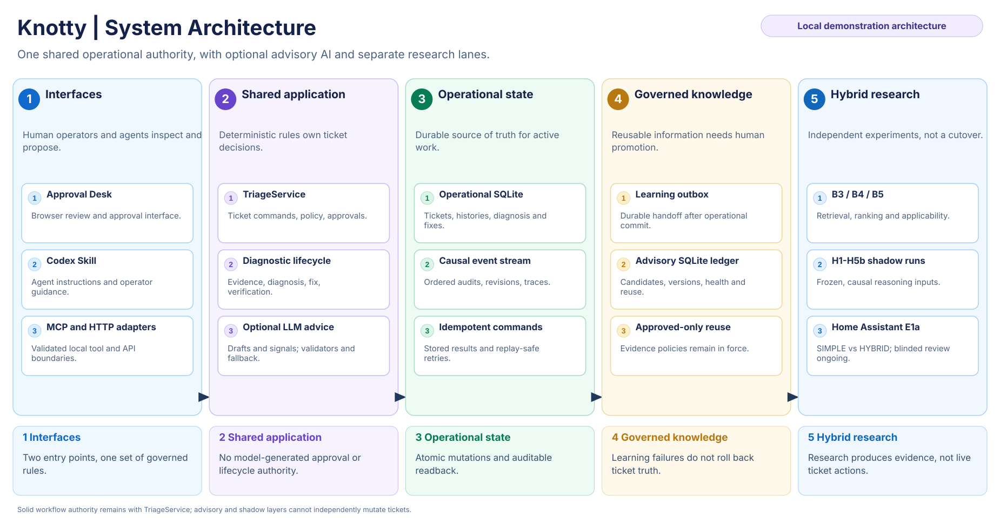
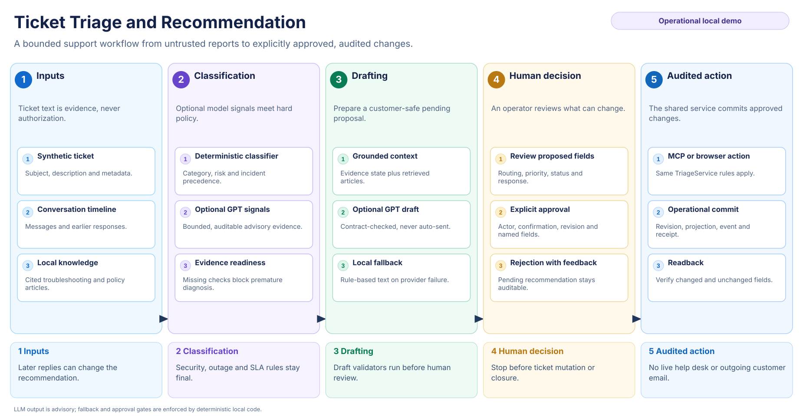
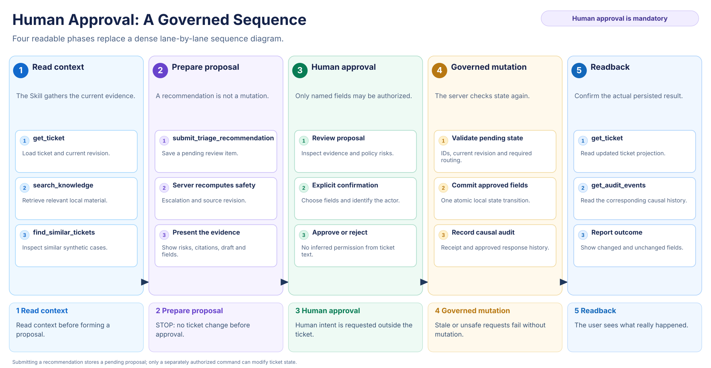
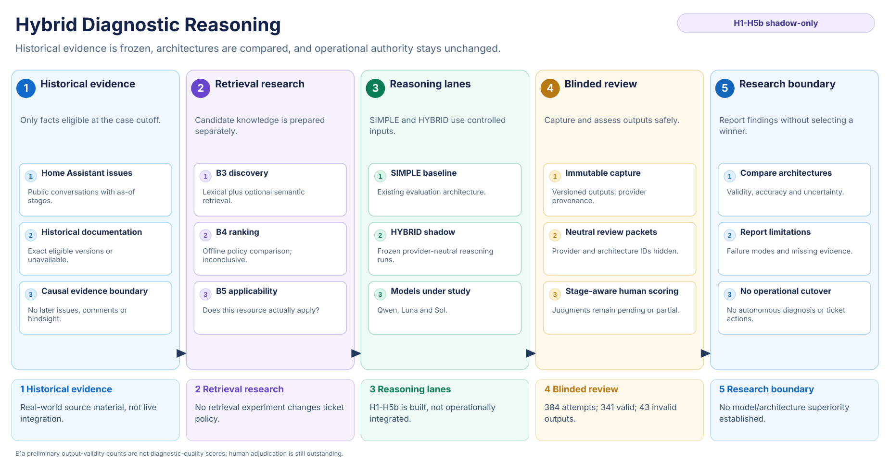
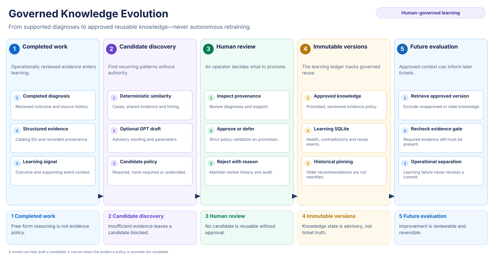
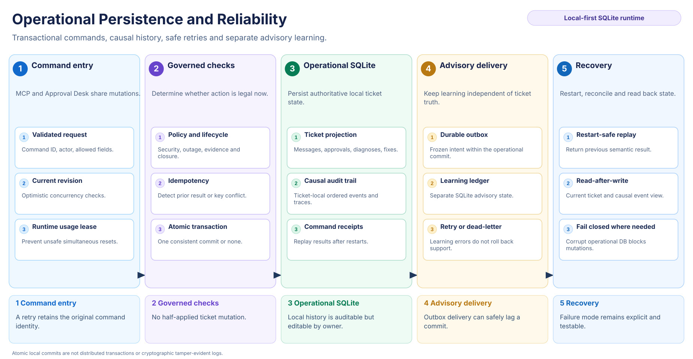

# Knotty

**Evidence-grounded support-ticket triage, diagnostics, and human-governed AI workflows.**

Imagine a customer reporting, “The campaign editor does not work.” Knotty brings the conversation and available evidence together, identifies missing information, and can propose a diagnosis for human review. A later reply or failed fix can change that conclusion. The local workflow preserves decisions and their supporting history so they can be inspected, replayed and considered for reviewed reuse.

This is an experimental project using controlled demonstration data, not a production customer-support platform.

[View the Engineering Case Study (PDF)](docs/presentations/knotty-project-overview.pdf) for an illustrated overview of the architecture, engineering decisions, evaluation evidence and limitations.

Knotty began as a personal experiment with **AI agent Skills** and **Model Context Protocol (MCP) servers**. Connecting an assistant to a few local tools raised harder questions: How can an agent reason about incomplete evidence? What happens when an investigation changes? Who can authorize a fix? Can earlier decisions be replayed after a restart?

What began as a tool-integration exercise evolved into a **local diagnostic and workflow engine**—and, more recently, an evaluation platform for hybrid retrieval, AI reasoning, and reliability engineering.

Knotty's central question is:

> **How do we build AI systems that do more than generate plausible answers—systems whose decisions are evidence-grounded, traceable, testable, and safe to act on?**

Knotty is an **experimental engineering project**, not a deployed customer-support platform. The local application operates on synthetic tickets and clean-room knowledge articles from *Northstar Marketing Cloud*, a fictional ecommerce marketing platform. There is no live help-desk connection or outgoing customer email. Separately, the research harness evaluates historical public Home Assistant issues and documentation—not live Home Assistant tickets.

[Try the demo](#quick-start) · [Understand the architecture](#architecture-in-one-picture) · [Explore Hybrid research](#hybrid-diagnostic-reasoning) · [Read the evaluation evidence](#evaluation-and-current-results) · [Detailed engineering reference](docs/engineering-reference.md)

## Quick start

Run the local **Approval Desk** to see a ticket move through classification, evidence gathering, human approval, diagnosis, verification, and closure.

**Requirements:** Node.js `^20.19.0`, `^22.12.0` or `>=24.0.0`; npm; and a local clone. The commands below use PowerShell, but the npm commands work from other shells.

~~~powershell
npm ci
npm run build

# Stop other Knotty runtime/MCP processes before resetting.
npm run reset:demo
npm run approval-desk
~~~

Open the URL printed by the server (normally `http://127.0.0.1:5177`). **Use `TKT-1010` first:** a vague report becomes an evidence-based product-performance investigation after a customer reply. The local demonstration can add a controlled synthetic reply after you approve an outbound update. For an incident-routing example, try `TKT-1001`.

What gets reset, and how do I keep the state?

**`npm run reset:demo` is destructive to local demo runtime state.** Stop all MCP and Approval Desk processes first. The reset restores both the authoritative operational state and advisory learning state.

For narrower resets, use `npm run reset:operational-demo` (tickets and workflow history) or `npm run reset:learning-demo` (advisory learning data). To retain changes across restarts, stop the Approval Desk with Ctrl+C and rerun `npm run approval-desk` **without** a reset. The reset controller uses leases, validation, rollback, and backup checks; its complete behavior is documented in the [engineering reference](docs/engineering-reference.md#reset-the-local-demo-state).

The browser interface provides the conversation timeline, current recommendation, evidence checklist, human-review controls, and audit context. Other views: [conversation workspace](docs/assets/approval-desk-conversation.png) and [recommendation panel](docs/assets/approval-desk-recommendation.png).

## What Knotty can do today

| Capability | Status and boundary |
| :--- | :--- |
| Local MCP server, Codex Skill, browser Approval Desk | **Implemented** for synthetic support tickets |
| Conversation-aware classification and evidence checks | **Implemented**; deterministic safety policy has final authority |
| Diagnostic lifecycle, diagnosis review, fixes, verification and closure | **Implemented** with explicit human gates |
| Optional GPT classification, diagnosis advice and response drafting | **Advisory**, contract-checked, with local fallback |
| Knowledge discovery, operator promotion and controlled reuse | **Implemented** with a separate advisory learning ledger |
| B3 semantic/lexical retrieval, B4 ranking, B5 applicability | **Research or shadow paths**; no automatic operational cutover |
| H1–H5b Hybrid reasoning | **Latest shadow architecture**, not fully integrated into the operational diagnosis path |
| SIMPLE vs. HYBRID / Qwen vs. Luna vs. Sol | **Historical Home Assistant experiment ongoing**; no diagnostic-accuracy winner |
| Live Zendesk/Jira/email integration, production identity boundary | **Not included** |

The application supports a ticket lifecycle rather than a one-shot classifier. A customer can provide new evidence, changing the classification, missing-evidence requirements, plausible diagnosis, or next permitted action. A failed fix or later reply can invalidate an earlier review. Neither a good-looking model explanation nor a retrieved article automatically proves a root cause.

## Architecture in one picture

[Open the system architecture at full size](docs/assets/knotty-system-overview.svg)

**One shared `TriageService` is authoritative.** The browser UI and MCP tools are adapters to the same application rules—not separate sources of truth. Four boundaries organize the system:

1. **Operational:** deterministic policy, approval checks, ticket lifecycle, causal events, and transactional state.
2. **Advisory AI:** optional model classification signals and drafts; outputs must pass validators and cannot authorize changes.
3. **Governed learning:** reviewed knowledge candidates become usable only through explicit promotion and approved evidence policies.
4. **Research/shadow:** retrieval, applicability and Hybrid reasoning experiments record observations without changing authoritative tickets.

### How a recommendation is produced

[Open the recommendation diagram at full size](docs/assets/knotty-recommendation-architecture.svg)

- **Input remains untrusted.** Ticket text, customer replies, and embedded instructions are evidence—not policy or approval.
- **Deterministic policy wins.** Security, outage, SLA, evidence-readiness, revision, and escalation rules cannot be overridden by an LLM.
- **Drafting is bounded.** Optional model-generated customer text must satisfy local response contracts; unavailable or invalid provider output falls back to deterministic drafting.
- **Nothing is automatically sent.** Approving a customer-response field records a local workflow event; the project has no external messaging integration.

The full classifier, drafting and safety details are in the [technical reference](docs/engineering-reference.md#hybrid-recommendation-architecture) and [threat model](SECURITY.md).

### Human approval and the ticket lifecycle

[Open the approval sequence at full size](docs/assets/knotty-approval-workflow.svg)

A proposal is not a ticket change. The operator first reviews evidence, risks, citations, proposed fields, and the customer-facing response. The service checks explicit actor/field authorization, source revision, routing, and lifecycle state before committing approved mutations. Readback confirms what changed and what stayed unchanged.

The lifecycle extends past this single approval:

`evaluate → collect evidence → record diagnosis → human diagnosis review → customer update → fix or escalation → verification → ready-to-close → explicit closure`

Exact actions vary by evidence and state. The system can **escalate unresolved ambiguity** instead of manufacturing a definitive answer. Fix approval is distinct from closure; new evidence can require review again.

The Approval Desk's **Workflow Bar** manages the current action, and the separate **Pattern Bar** appears for governed knowledge discovery. Their blocking reviews are enforced through the same backend service.

For a chronological MCP replay without network calls:

~~~powershell
npm run evaluate:lifecycle-replay
~~~

[Detailed diagnosis-and-fix walkthrough](docs/diagnosis-review-example.md) · [Lifecycle replay guide](docs/lifecycle-replay.md) · [Full MCP action contracts](docs/engineering-reference.md#mcp-interface)

## Hybrid diagnostic reasoning

Hybrid is **the latest architectural expansion**, but it must not be mistaken for an operationally deployed replacement for the existing SIMPLE workflow.

[Open the Hybrid architecture at full size](docs/assets/knotty-hybrid-research.svg)

The research architecture keeps the following pieces separate:

| Research component | What is implemented or being investigated |
| :--- | :--- |
| **B3 discovery** | Local-first lexical retrieval, optional semantic embeddings, and provenance-preserving candidate sets across articles, known causes, playbooks and eligible resolved cases |
| **B4 ranking** | Offline lexical/semantic/reciprocal-rank-fusion comparisons; development evidence was **inconclusive**, so no ranking policy was promoted to authority |
| **B5 applicability** | Research on whether evidence actually applies to a case, including abstention and negative controls |
| **H1–H5b Hybrid reasoning** | Frozen, causally eligible inputs; provider-neutral contracts; immutable shadow runs; replay, idempotency and safe failure handling |
| **Operational integration** | **Not completed**; shadow output cannot approve, diagnose authoritatively, fix or close tickets |

The purpose is not merely to supply more context to an LLM. It's to ask whether combining **retrieval, structured evidence, diagnostic taxonomy, and model reasoning** produces better-supported hypotheses without encouraging unsupported certainty or leaking knowledge from the future.

The experiments include an existing **SIMPLE baseline** and a **HYBRID shadow lane**. Provider/model identity is kept separate from the case opportunity and the human review packet. A claim that Hybrid works better requires scored, comparable results—not just successful execution.

**Semantic retrieval is an optional research channel**, with working components and bounded development evaluations, rather than a proven production capability. RAG (retrieval-augmented generation) supplies retrieved material to a model; B5 applicability assessment investigates whether that material actually supports the current case. Neither retrieval nor a valid model response establishes a correct diagnosis.

### Bounded Luna comparisons in the case study (29 October 2026)

The presentation's fresh SIMPLE/Luna and B5/H5b HYBRID/Luna comparisons used **lexical retrieval, with semantic vectors inactive**. They ran against an isolated local evaluation revision, not an operational cutover on this repository's main branch.

The separate ranking follow-up compared the full candidate pool with existing B4 lexical selection plus preserved references on **four paired synthetic cases (eight outputs)**. API-reported input tokens fell from **85,300 to 43,559**, a **48.9% reduction**, while **8/8 labeled relevant resource/case pairs were retained**. This is a bounded context-selection result. It does not establish improved diagnostic quality, semantic-retrieval benefit, or billing savings. Cache conditions differed between the two inputs, so fewer input tokens cannot be read as a measured cost saving.

**Human quality review remained pending at the time of the presentation.** The PDF preserves that dated result and its limitations; it does not report a diagnostic-accuracy winner. These synthetic Luna experiments are separate from the historical Home Assistant E1a experiment below and the earlier Qwen retrieval study.

[Hybrid shadow runner design](docs/superpowers/plans/2026-09-24-h5a-hybrid-shadow-runner.md) · [B3 retrieval plan](docs/superpowers/plans/2026-09-12-hybrid-retrieval-b3-implementation-plan.md) · [B4 ranking](docs/superpowers/plans/2026-09-16-b4-ranking.md) · [B5 applicability](docs/superpowers/plans/2026-09-17-b5-applicability-evaluation.md) · [Hybrid implementation PR #30](https://github.com/MatiasLaukka/Support-Ticket-Triage-MCP/pull/30)

### Home Assistant historical-case experiment (E1a)

Knotty's earlier demonstrations use fictional support tickets. The E1a research goes further by studying **historical public Home Assistant GitHub issues and time-eligible documentation**. This is a controlled, local historical-case experiment, **not** an integration with Home Assistant support or an endorsed benchmark.

Every stage is limited by an `asOf` cutoff. A model should not see later GitHub comments, future solutions, or current documentation substituted for a missing historical version. Eligible documentation must have exact historical provenance and content hashes; otherwise it stays **unavailable**.

**Preliminary technical results — October 2026**

| Measure | Status |
| :--- | ---: |
| Public historical cases | **24** |
| Time-scoped evidence checkpoints | **64** |
| SIMPLE/HYBRID × Qwen/Luna/Sol attempts | **384** |
| Structurally valid provider outputs | **341** |
| Invalid provider outputs | **43** |
| Valid-output packets prepared for blinded review | **341** |
| Completed diagnostic-accuracy comparison | **Not yet available** |

**341/384 is an output-validity result, not diagnosis accuracy.** Malformed outputs remain reliability failures but do not receive invented human semantic ratings. Model and architecture identities remain concealed during blinded review; no provider ranking, Hybrid superiority claim, or winner is justified while adjudication and analysis are unfinished.

The E1a harness and raw evaluation artifacts currently reside in a **separate local experimental worktree** rather than in a reproducible benchmark command on this repository's main branch. Earlier local Qwen semantic-retrieval metrics and other controlled GPT comparisons are **different experiments**.

## Governed knowledge evolution

[Open the knowledge evolution diagram at full size](docs/assets/knotty-knowledge-evolution.svg)

Knotty can suggest reusable knowledge after supported diagnoses, but this is **not autonomous model retraining**: no model can promote its own candidates or convert a discovered pattern into policy.

The sequence is: **observed evidence → completed diagnosis → deterministic candidate discovery → optional advisory drafting → human policy review → explicit promotion → versioned future reuse**. Candidates with incomplete or undecided evidence policies stay blocked. An approved known cause can still require new evidence in a later ticket; rejected, stale and contradicted objects do not silently become operational truth.

The **SQLite learning ledger** tracks candidate **maturity and health**, explicit promotions, immutable versions, reuse events and contradictions. Previously evaluated tickets retain their original source versions, so **historical recommendations remain unchanged** even as the approved knowledge catalog evolves.

~~~powershell
npm run demo:knowledge-evolution
npm run demo:learning-ledger
npm run evaluate:knowledge-holdout
~~~

[Detailed evidence-policy rules](docs/knowledge-evolution.md) · [Learning and operational failure boundaries](docs/engineering-reference.md#governed-knowledge-evolution)

## Persistence and reliability

[Open the persistence and reliability diagram at full size](docs/assets/knotty-persistence-reliability.svg)

The authoritative operational plane uses **transactional SQLite**, not a set of mutable JSON/JSONL ticket records. Governed commands commit the projection/revision, ticket-local causal event, safe trace, replay result and any learning-outbox intent together.

| Problem | Design choice |
| :--- | :--- |
| Stale human decisions | Optimistic source-revision and approval-time checks |
| Duplicate clicks or lost responses | Stable command IDs and persistent idempotent results |
| Ordering and auditability | Causal ticket-local event sequences and safe read models |
| Crash/restart uncertainty | Replayed command receipts; no reapplication of successful mutation |
| Learning repository unavailable | Operational success is isolated; advisory delivery retries or reports unavailability |
| Demo reset during a running process | Usage leases, guarded reset, verification and rollback |

These are **local reliability guarantees**. SQLite files can still be modified by someone with filesystem access; this is neither a distributed multi-tenant help desk nor a cryptographically tamper-evident audit ledger.

~~~powershell
npm run demo:operational-persistence
npm run evaluate:lifecycle-replay
~~~

For actual migration states, import contracts, reset safeguards, and crash/recovery restrictions, use the [engineering reference](docs/engineering-reference.md#operational-persistence-and-cutover).

## Using the MCP server and Codex Skill

The repository-local Skill teaches Codex to inspect the current workflow, gather evidence, propose the next action and **pause at the approval boundary**.

1. Run `npm ci` and `npm run build` in the repository root.
2. Open the root as a project in Codex desktop. Review and trust [`.codex/config.toml`](.codex/config.toml); it starts `node dist/src/index.js` using the project working directory.
3. Start a new thread and invoke the [`triaging-support-tickets` Skill](.agents/skills/triaging-support-tickets/SKILL.md).

~~~text
Use $triaging-support-tickets to review TKT-1005.
Show evidence, citations, escalation risks and proposed fields.
Stop and wait for my explicit approval before changing anything.
~~~

The standalone `npm start` script runs the **stdio MCP server**, not an HTTP page. An idle terminal is expected while it waits for MCP messages.

The server exposes **27 typed tools, 4 resources and 3 prompts** (at the documented implementation baseline). Useful starting points include `list_tickets`, `get_ticket_workflow`, `search_knowledge`, `evaluate_ticket`, `record_diagnosis`, `review_diagnosis`, `mark_response_done`, and `get_audit_events`. Every mutation has specific schema and policy constraints; use the [complete read, mutation, resource and prompt reference](docs/engineering-reference.md#mcp-interface).

### Optional model assistance

By default, the Approval Desk uses deterministic response drafting and needs **no API key**. Explicit opt-in example:

~~~powershell
$env:OPENAI_API_KEY = 'set-locally-do-not-commit'
$env:APPROVAL_DRAFT_PROVIDER = 'openai'
npm run approval-desk
~~~

Provider availability is not required for deterministic routing, lifecycle, audit, or approval checks. Don't put credentials in tickets, screenshots or committed configs.

### Useful configuration defaults

| Environment setting | Default |
| :--- | :--- |
| `TRIAGE_DATA_ROOT` | `data/runtime` |
| `TRIAGE_SEED_FILE` | `data/seed/tickets.json` |
| `TRIAGE_KNOWLEDGE_ROOT` | `data/knowledge` |
| `OPERATIONAL_DB_PATH` | `data/runtime/operational.sqlite` |
| `TRIAGE_LEARNING_LEDGER_PATH` | `data/runtime/knowledge-evolution/learning.sqlite` |
| `TRIAGE_KNOWLEDGE_APPROVERS` | `support-lead,reviewer,approval-desk` |
| `TRIAGE_MINUTES_SAVED` | `8` (an assumption, **not** measured labor time) |

[Advanced environment/provider options](docs/engineering-reference.md#architecture) · [Safe reset guidance](docs/engineering-reference.md#reset-the-local-demo-state) · [Retrieval index controls](docs/engineering-reference.md#b3-retrieval-operations)

## Evaluation and current results

Different harnesses answer different questions. **Fixture agreement**, **local controlled simulation**, **provider-output validity**, and **live-model diagnostic quality** are not interchangeable metrics.

| Command | What it proves (and what it does not) |
| :--- | :--- |
| `npm test` | Build, typecheck and local Vitest regression tests |
| `npm run evaluate` | Agreement between 30 **preconstructed** recommendations and expected outcomes; **not unseen-ticket accuracy** |
| `npm run evaluate:diagnostics` | 11 controlled scenarios across 8 diagnostic families; nonmutating checks |
| `npm run evaluate:lifecycle` | Deterministic audit across all 30 seeded tickets; not 30 full chronological replays |
| `npm run evaluate:lifecycle-replay` | Real MCP lifecycle and read-before-action gates using temporary state |
| `npm run evaluate:knowledge-holdout` | Controlled future-turn evidence and approved-knowledge reuse |
| `npm run evaluate:ai-comparison` | Controlled local deterministic/advisory classifier and draft lanes; `--live` is explicitly opt-in |
| `npm run evaluate:ai-diagnosis` | Article-backed diagnoses and controlled optional advisory providers |
| `npm run evaluate:retrieval` | Local retrieval metrics; optional separately configured semantic experiments |
| `npm run evaluate:ranking` / `npm run evaluate:applicability` | B4/B5 **development** research, not an authorized operational ranking policy |

To run the broad local verification (no live-model calls by default):

~~~powershell
npm ci
npm test
npm run verify:portfolio
~~~

The 30-ticket seeded `evaluate` sample is intentionally constructed to match its reference outcomes; a printed perfect accuracy from that sample is **not evidence of real-world diagnostic performance**. Likewise, older GPT response-quality figures represent specific dated controlled or authenticated runs with separately documented limitations. E1a human evaluation is **still in progress**.

[Full metrics, historical scorecards and commands](docs/engineering-reference.md#reproducible-evaluation) · [Diagnostic harness methods](docs/diagnostic-evaluation-harness.md) · [AI comparison example](docs/ai-comparison-example.md) · [Retrieval reports](reports/retrieval/)

## Trust boundaries and limitations

- **Synthetic local application:** No live customer data, messaging, Zendesk/Jira updates, paging, or identity-provider integration. Home Assistant issues are historical external research inputs only.
- **Prompt injection:** Ticket text and retrieved content cannot authorize actions, rewrite policy, or approve fields.
- **Explicit human intent:** Pending proposals need review; an MCP payload alone cannot establish that a human personally intended an approval.
- **Causal time:** Historical research must exclude future comments and documentation versions unavailable by the case cutoff.
- **Provider uncertainty:** Malformed, contradictory, or unsupported model output can fail, abstain or fall back. Research gains are not assumed.
- **Audit and persistence:** Local SQLite transactions are durable within documented conditions but aren't distributed, authenticated, or tamper-proof.
- **Reported savings:** Queue `estimatedMinutesSaved` uses a configured assumption per approved recommendation, not stopwatch measurements.
- **Fixed fixtures:** Synthetic SLA deadlines use June 10, 2026; use historical `asOf` where time dependence matters.

See [SECURITY.md](SECURITY.md) for the full threat model and [limitations in the engineering reference](docs/engineering-reference.md#limitations-and-residual-risks).

## Repository guide

| Where to look | Purpose |
| :--- | :--- |
| [`src/triage-service.ts`](src/triage-service.ts) | Authoritative governed commands |
| [`src/policy.ts`](src/policy.ts) | Escalation, validation and field rules |
| [`src/server.ts`](src/server.ts) | MCP tools, resources, prompts and error boundaries |
| [`src/approval-desk/`](src/approval-desk/) | Browser workflow, classification and drafting |
| [`src/operational/`](src/operational/) | Transactional SQLite, event projections and replay |
| [`src/knowledge-evolution/`](src/knowledge-evolution/) | Candidate governance, approved reuse and learning ledger |
| [`src/retrieval/`](src/retrieval/) | Lexical/semantic retrieval, ranking, applicability |
| [`src/reasoning/`](src/reasoning/) | Frozen-input Hybrid shadow reasoning |
| [`data/seed/`](data/seed/) and [`data/knowledge/`](data/knowledge/) | Local synthetic fixtures and articles |
| [`test/`](test/) and [`scripts/`](scripts/) | Regression tests, demos and evaluators |
| [`.agents/skills/triaging-support-tickets/`](.agents/skills/triaging-support-tickets/) | Codex Skill and policy guidance |

**Documentation:** [Architecture audit](docs/architecture-review/README.md) · [Engineering reference](docs/engineering-reference.md) · [Case study](docs/case-study.md) · [Demo walkthrough](docs/demo-script.md) · [Knowledge evolution](docs/knowledge-evolution.md) · [Lifecycle viewer](docs/lifecycle-replay.md) · [Evaluation guide](docs/diagnostic-evaluation-harness.md) · [Roadmap](docs/roadmap.md) · [Capture guide](docs/capture-guide.md).

---

*Knotty is an ongoing personal engineering project. The implemented system is built around human oversight, deterministic policy and reproducible evidence; the Hybrid research asks how far that architecture can be improved without losing those boundaries.*
