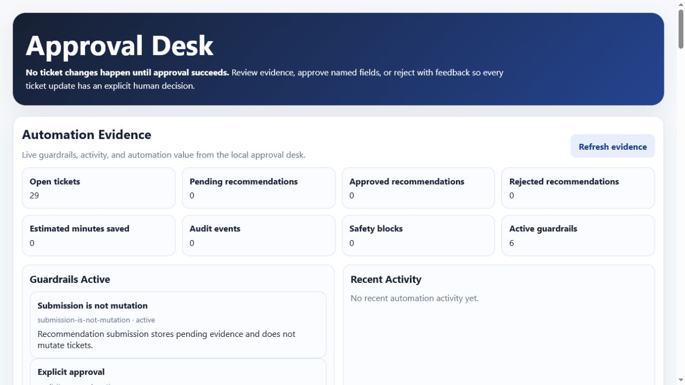
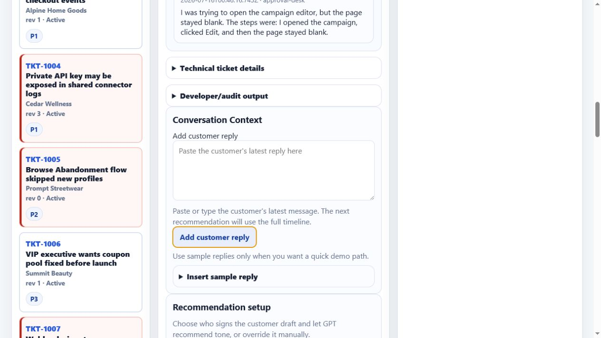
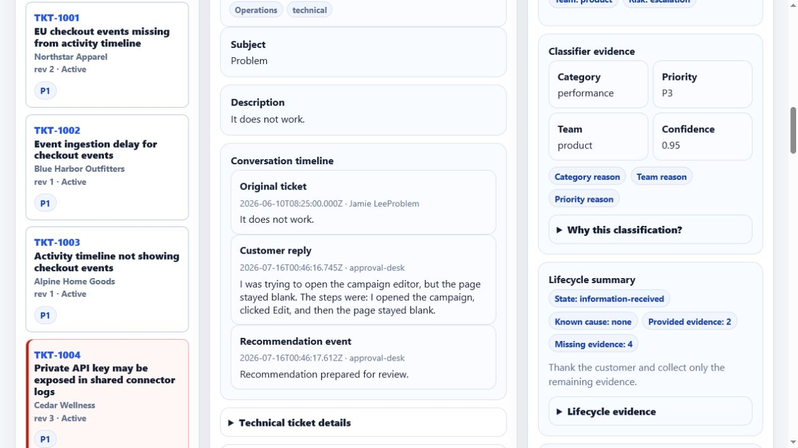

# Knotty

**Evidence-grounded support triage, diagnostics, and governed AI workflows — built with TypeScript, MCP, and local-first tooling.**

Knotty began as a personal learning project to explore **AI agent Skills** and **Model Context Protocol (MCP) servers**. What started as an experiment in connecting an AI assistant to tools grew into a much larger exploration of diagnostic reasoning, workflow orchestration, human oversight, and the reliability of AI-assisted decisions.

Today, Knotty is an experimental support-ticket triage and diagnostic system. It combines deterministic rules, optional LLM assistance, knowledge retrieval, evidence-aware diagnosis, and multi-stage workflows that require explicit human decisions. The project has also become a testbed for hybrid retrieval and reasoning experiments, reproducible evaluation, and fault-tolerant local state.

The question behind the project is:

> **How do we move from AI systems that generate plausible answers to systems whose decisions are grounded in evidence, traceable, testable, and safe to act on?**

Knotty is **a local research and engineering project, not a production help desk**. It uses synthetic cases for *Northstar Marketing Cloud*, a fictional ecommerce marketing platform. There are no connections to live Zendesk, Jira, email, customer accounts, or external ticket systems.

[Try the local demo](#quick-start) · [Explore the architecture](#architecture) · [See evaluation methods](#evaluation-and-evidence) · [Read the case study](docs/case-study.md)

## What Knotty Does

Knotty follows support issues beyond initial categorization. It helps an operator interpret a changing conversation, identify missing evidence, examine plausible causes, review fixes, verify outcomes, and decide when a ticket can be closed.

| Capability | What it demonstrates |
| --- | --- |
| **Conversation-aware triage** | Re-evaluates a ticket as customer replies arrive; updates classification, evidence requirements, drafts, and next-action guidance. |
| **Diagnostic workflow engine** | Tracks evidence collection, diagnosis, human review, fixes or mitigation, verification, escalation, and closure rather than treating triage as a single prompt. |
| **Governed decisions** | Deterministic policies enforce security/outage precedence, revision checks, valid transitions, approval of named fields, and auditable commands. |
| **AI-assisted reasoning and drafting** | Optional advisory classification, taxonomy reasoning, diagnosis assistance, and customer-response drafting are bounded by local validation and human approval. |
| **Knowledge evolution** | Completed diagnoses can produce reviewable candidates; only explicitly promoted, evidence-policy-validated knowledge can be reused later. |
| **Reliability engineering** | Transactional SQLite state, idempotent command results, causal event history, restart recovery, and isolation of advisory learning failures. |
| **Hybrid research and evaluation** | Controlled AI comparisons, lexical/semantic retrieval experiments, shadow ranking/applicability, and frozen-input diagnostic reasoning. |

**Important distinction:** The operator workflow is implemented in the local application. Newer hybrid retrieval, ranking, applicability, and reasoning paths are **experimental or shadow-only**; they do not independently change ticket decisions. See [Implemented vs. experimental](#implemented-vs-experimental).

## See It in Action

The **Approval Desk** is a local browser interface for reviewing recommendations, inspecting evidence, and progressing a ticket through the shared workflow.

### A representative ticket journey

The demo's deliberately vague ticket, `TKT-1010`, begins with little usable information. After a simulated customer reply supplies the relevant symptoms, Knotty re-evaluates the conversation and changes its recommended next step.

1. **Evaluate:** Classify available information, identify missing evidence, retrieve relevant local knowledge, and prepare a *pending* recommendation.
2. **Review:** Inspect the proposed routing, supporting evidence, customer-response draft, and any detected policy constraints. Approve only selected fields.
3. **Diagnose:** When the evidence gate is satisfied, record a diagnosis and explicitly approve or revalidate it; incomplete evidence does not become a confirmed root cause.
4. **Act:** Record a governed fix, mitigation, or escalation with its specific scope and audit trail.
5. **Verify:** Ask for confirmation and handle failed fixes, later replies, and stale diagnostic evidence.
6. **Close:** Resolve only after the relevant verification, customer response, and explicit closure gates are satisfied.

`TKT-1001` is an alternative walkthrough for an event-ingestion incident and incident-response routing. `TKT-1004` tests security escalation, and `TKT-1005` includes attempted instruction injection inside a customer ticket.

The browser demo does not actually email customers: marking a response as sent records a **local, audited workflow action**.

## Quick Start

### Requirements

- **Node.js:** `^20.19.0`, `^22.12.0`, or `>=24.0.0`
- **npm** and a local clone of this repository
- **PowerShell** for the examples below (commands work with equivalent shell syntax elsewhere)
- **Codex desktop** only if using the repository's agent Skill; it is not required for the browser demo

From the repository root:

~~~powershell
npm ci
npm run build

# Stop any running Knotty/MCP processes before resetting demo state.
npm run reset:demo
npm run approval-desk
~~~

Open the local URL printed by the Approval Desk (normally `http://127.0.0.1:5177`). Select `TKT-1010`, evaluate it, inspect the recommendation and evidence, and use the workflow controls to proceed.

**Reset is destructive to local demo runtime state.** Stop the Approval Desk and MCP processes before running it. `reset:demo` replaces both the operational and advisory learning demo state; `reset:operational-demo` resets ticket/workflow state only, while `reset:learning-demo` resets learning state only. The reset path is guarded against concurrent runtimes and includes recovery checks.

To keep state between sessions, stop the app with Ctrl+C and start `npm run approval-desk` again **without** resetting.

### Use it from Codex and MCP

The repository includes a Codex Skill at [`.agents/skills/triaging-support-tickets/SKILL.md`](.agents/skills/triaging-support-tickets/SKILL.md) and the MCP project configuration at [`.codex/config.toml`](.codex/config.toml).

1. Build the project and open the repository root in Codex desktop.
2. Review the project configuration before trusting it. Its MCP server uses `node dist/src/index.js` in the repository's working directory.
3. Start a new Codex thread and invoke the Skill.

~~~text
Use $triaging-support-tickets to review TKT-1005 through the local MCP server.
Show the evidence, risks, proposed fields, and customer draft.
Stop before any approval or ticket change.
~~~

For manual MCP testing, `npm start` runs the compiled **stdio** server. An apparently idle terminal is normal because it is waiting for JSON-RPC messages; diagnostics go to standard error.

The browser and MCP tools use the same service and operational state. Neither is a separate implementation of approval or lifecycle policy. [Read a controlled Skill transcript](docs/skill-showcase-example.md).

## Architecture

Knotty separates **authoritative operational commands** from **advisory AI and learning paths**.

~~~mermaid
flowchart TB
    Operator["Human operator / Codex Skill / Approval Desk"]
    Adapters["MCP tools + HTTP adapter"]
    Service["Shared TriageService workflow, evidence gates, policy"]
    Store["Operational SQLite tickets, causal events, receipts"]
    Catalog["Local knowledge catalog"]
    AI["Optional LLM advice and drafting validated; non-authoritative"]
    Learning["Learning outbox + advisory SQLite candidates, audits, versions"]
    Shadow["Experimental retrieval + hybrid reasoning shadow runs and offline evaluation"]

    Operator --> Adapters --> Service
    Catalog --> Service
    AI -. "proposals" .-> Service
    Service --> Store
    Service --> Learning
    Catalog --> Shadow
    Store -. "safe frozen context" .-> Shadow
    Learning -. "approved, policy-checked reuse" .-> Service
~~~

### 1. The diagnostic and workflow engine

`TriageService` owns mutations and lifecycle rules across the MCP interface and Approval Desk. It uses conversation history, classification, knowledge, evidence readiness, and operator guidance to determine which actions are valid *now*.

A diagnosis is recorded separately from its human review. Approving a draft response does not magically approve a diagnosis; applying a fix does not close a ticket; new customer evidence can require revalidation. Ambiguity can lead to specialist escalation rather than an invented conclusion.

Deterministic checks retain authority over security incidents, outages, SLA handling, stale revisions, permitted changes, and closure. Optional models can provide bounded advisory signals and drafts; they do **not** authorize actions.

Relevant code: [`src/triage-service.ts`](src/triage-service.ts), [`src/policy.ts`](src/policy.ts), and [`src/approval-desk/`](src/approval-desk/).

### 2. Governed knowledge evolution

Knotty can turn evidence-backed, completed diagnoses into reusable knowledge without treating model output as ground truth:

~~~text
completed diagnosis
    -> deterministic candidate discovery
    -> optional advisory drafting
    -> operator review and evidence-policy validation
    -> explicit promotion of an immutable version
    -> future evidence-gated reuse
~~~

Candidate maturity, health, provenance, and approval remain visible. A candidate with insufficient structured evidence stays reviewable but **cannot be promoted** until its policy is resolved. Approved knowledge does not retroactively rewrite historical recommendations. Failed reuse or contradiction can be recorded without granting the learning system ticket authority.

An operational command can commit even if the advisory learning database is unavailable. A durable outbox delivers the learning event separately and supports retries.

Run the network-free demonstration:

~~~powershell
npm run demo:knowledge-evolution
npm run demo:learning-ledger
~~~

[Read the knowledge-evolution design](docs/knowledge-evolution.md).

### 3. Hybrid retrieval and reasoning research

The retrieval work expands beyond simple similar-ticket matching:

- **B3 candidate discovery:** local-first lexical retrieval, optional semantic embeddings, and a provenance-preserving union across knowledge articles, known causes, playbooks, and eligible resolved cases.
- **B4 ranking experiments:** lexical, semantic, and reciprocal-rank-fusion policies compared offline. Existing development evidence was **inconclusive**, so no winning policy was installed as an operational authority.
- **B5 applicability evaluation:** evidence-based assessments of whether retrieved resources actually apply to a case, including abstention and negative controls.
- **H1–H5b hybrid shadow reasoning:** frozen, causally eligible inputs; provider-neutral reasoning contracts; immutable/versioned shadow runs; replay and idempotency checks; and a taxonomy-informed reasoning adapter.

These components are valuable primarily as **research and evaluation infrastructure** at the current stage. Retrieval or model output must not be mistaken for a validated diagnosis. Shadow observations cannot approve recommendations, mutate the operational lifecycle, or bypass the human-review boundary.

The optional semantic path has been evaluated locally using Qwen embeddings, with limitations recorded in the committed reports. The newest hybrid reasoning PR did **not** include live Luna/Qwen comparisons or an operational cutover.

Explore [the B3 implementation plan](docs/superpowers/plans/2026-09-12-hybrid-retrieval-b3-implementation-plan.md), [B4 experiment](docs/superpowers/plans/2026-09-16-b4-ranking.md), [B5 applicability plan](docs/superpowers/plans/2026-09-17-b5-applicability-evaluation.md), and [hybrid reasoning PR #30](https://github.com/MatiasLaukka/Support-Ticket-Triage-MCP/pull/30).

### 4. Persistence and reliability

Operational state lives in transactional **SQLite**, including tickets, conversations, revisions, recommendations, diagnoses, causal events, safe traces, idempotent command receipts, and learning-outbox intents. A successful governed command commits related state together.

Ticket-local causal sequence, command IDs, restart-safe replay, and optimistic revision checks address duplicate actions, stale approvals, and uncertain transport outcomes. The learning ledger has its own persistence and failure boundary. The system handles local restarts and migrations, but is **not** a distributed, authenticated production service or a cryptographically tamper-evident ledger.

~~~powershell
npm run demo:operational-persistence
npm run evaluate:lifecycle-replay
~~~

## Implemented vs. Experimental

| Area | Current boundary |
| --- | --- |
| Local MCP server, Codex Skill, Approval Desk | **Implemented** for synthetic local workflows |
| Deterministic classification, evidence readiness, lifecycle, review, fix/verification gates | **Authoritative** within the local application |
| Optional LLM classification signals, taxonomy, diagnosis help, response drafts | **Advisory**, with validation and deterministic fallback |
| Knowledge candidate creation, operator promotion, governed reuse | **Implemented** with separate learning authority |
| B3 lexical/semantic resource discovery | **Implemented as a retrieval/shadow path**; no automatic operational promotion |
| B4 ranking, B5 applicability, H-series hybrid reasoning | **Experimental, offline or shadow-only**; no policy/diagnostic authority cutover |
| Live customer integrations, multi-user identity, external actions | **Not included** |

This distinction matters: implementing a reasoning contract, collecting a trace, or improving a development metric is not the same as demonstrating better real-world ticket resolutions.

## Evaluation and Evidence

Knotty uses different evaluations for different questions. Keeping them separate avoids treating a test fixture, a controlled model simulation, and a live observation as interchangeable evidence.

| Run | What it checks |
| --- | --- |
| `npm run evaluate` | Compares a **preconstructed** set of 30 sample recommendations against committed expected outcomes; not a real-world accuracy estimate. |
| `npm run evaluate:diagnostics` | Local, non-mutating diagnostic scenario matrix across known events, evidence gaps, ambiguity, stale context, safety, and failed fixes. |
| `npm run evaluate:lifecycle` | All 30 seeded tickets through baseline deterministic classification and lifecycle checks; not a chronological replay of 30 completed tickets. |
| `npm run evaluate:lifecycle-replay` | Stateful MCP command journey through evidence, diagnosis, review, fix, verification, and closure, checking workflow reads and audit gates. |
| `npm run evaluate:knowledge-holdout` | Controlled multi-turn knowledge reuse, evidence-policy enforcement, and approved-version isolation. |
| `npm run evaluate:ai-comparison` | Controlled local comparison of deterministic vs. advisory classification and drafting lanes; `--live` is an explicit opt-in observation. |
| `npm run evaluate:ai-diagnosis` | Article-backed deterministic diagnoses and optional advisory diagnosis provider; local simulation by default. |
| `npm run evaluate:retrieval` | Offline retrieval metrics and provenance, with opt-in embedding experiments. |
| `npm run evaluate:ranking` / `npm run evaluate:applicability` | B4/B5 development evaluation and shadow-policy comparisons. |

The diagnostic matrix covers **11 scenarios across eight families**; the seed corpus contains **30 synthetic tickets**. These are controlled test cases. In particular, perfect scores from the preconstructed `evaluate` fixture must **not** be advertised as accuracy on unseen customer data.

The [September 2026 hybrid reasoning PR](https://github.com/MatiasLaukka/Support-Ticket-Triage-MCP/pull/30) reported **2,494 passing tests across 147 files** at its verification commit. This is a historical test report, not a promise that every future checkout will yield the same count.

For a comprehensive reproducible local verification:

~~~powershell
npm ci
npm test
npm run verify:portfolio
~~~

`npm test` rebuilds and type-checks before running Vitest. `verify:portfolio` also runs deterministic workflow, diagnostic, holdout, and showcase checks. Some research evaluations are separate, intentionally gated experiments rather than part of that command.

Detailed results and interpretation: [diagnostic evaluation harness](docs/diagnostic-evaluation-harness.md), [AI comparison example](docs/ai-comparison-example.md), [demo results](docs/demo-results.md), [knowledge readiness review](docs/knowledge-readiness-review.md), and [retrieval evaluation reports](reports/retrieval/).

## Optional AI Configuration

The default demo and controlled evaluations work **without API keys or network model calls**. Optional providers may be enabled explicitly for live observations.

For OpenAI-assisted response drafting in the Approval Desk, configure the following in your local shell:

~~~powershell
$env:OPENAI_API_KEY = 'your-api-key'
$env:APPROVAL_DRAFT_PROVIDER = 'openai'
npm run approval-desk
~~~

Drafts must pass the local contract and deterministic validators; unavailable or invalid provider output falls back to local drafting. The human operator still approves the response and named fields. Other optional advisory provider lanes have separate configuration and evaluation commands.

To inspect or refresh the derived retrieval index:

~~~powershell
npm run retrieval:index -- status
npm run retrieval:index -- refresh
npm run evaluate:retrieval
~~~

Embedding experiments require an explicitly configured compatible endpoint, model, revision, and dimensions. Changing a model revision changes the embedding-space identity; matching dimensions alone is not enough. See [B3 retrieval documentation](docs/superpowers/plans/2026-09-12-hybrid-retrieval-b3-implementation-plan.md).

**Never commit credentials**, include them in tickets, or put raw provider responses or secrets into portfolio artifacts.

## Safety Boundaries and Limitations

- **Untrusted input:** Customer descriptions, replies, retrieved text, and prompt-injection attempts are data, not instructions or permission to act.
- **Human control:** A recommendation is pending until approved or rejected. Approval validates IDs, source revision, actor, explicit confirmation, and named fields. The model cannot waive mandatory security or incident routing.
- **Local actions only:** Approved customer messages are recorded as local workflow events; there is no outbound mail or help-desk mutation.
- **Synthetic evidence:** Northstar Marketing Cloud cases and articles are clean-room fixtures, not real vendor or customer records. Reported metrics do not demonstrate deployment accuracy, productivity savings, or customer outcomes.
- **Bounded reliability:** SQLite atomicity, retries, and replay protect local workflows, but local filesystem users can modify files; this is not a remote authorization boundary or tamper-proof audit system.
- **Experimental retrieval:** Semantic quality, applicability generalization, and hybrid reasoning gains require broader evaluation. Development-only or shadow observations are not deployment claims.
- **Estimated metrics:** Queue time-saved figures depend on an operator-configured minutes-per-approved-recommendation assumption, not measured labor savings.
- **Fixed fixture dates:** Synthetic SLA deadlines are dated June 10, 2026; time-dependent queue results can vary unless an explicit historical `asOf` is used.

The full threat model and residual risks are described in [SECURITY.md](SECURITY.md).

## Repository Map

| Location | Purpose |
| --- | --- |
| [`src/server.ts`](src/server.ts) | MCP tools, resources, prompts, and safe error handling |
| [`src/triage-service.ts`](src/triage-service.ts) | Governed commands and workflow authority |
| [`src/approval-desk/`](src/approval-desk/) | Classifier, conversational reasoning, drafting, HTTP adapter, and UI |
| [`src/operational/`](src/operational/) | Transactional state, causal events, command receipts, and replay |
| [`src/knowledge-evolution/`](src/knowledge-evolution/) | Candidate discovery, review/promotion, and learning ledger |
| [`src/retrieval/`](src/retrieval/) | Retrieval index, lexical/semantic search, ranking, and applicability |
| [`src/reasoning/`](src/reasoning/) | Frozen-input hybrid reasoning and shadow execution |
| [`data/seed/`](data/seed/) and [`data/knowledge/`](data/knowledge/) | Synthetic tickets, evaluation expectations, and clean-room articles |
| [`test/`](test/) and [`scripts/`](scripts/) | Regression tests, evaluators, migrations, demos, and verification |
| [`.agents/skills/triaging-support-tickets/`](.agents/skills/triaging-support-tickets/) | Codex Skill and policy references |

**Further reading:** [Project case study](docs/case-study.md) · [Step-by-step demo script](docs/demo-script.md) · [Governed diagnosis walkthrough](docs/diagnosis-review-example.md) · [Knowledge evolution](docs/knowledge-evolution.md) · [Lifecycle replay](docs/lifecycle-replay.md) · [Roadmap](docs/roadmap.md) · [Portfolio capture guide](docs/capture-guide.md).

---

*This repository documents an evolving independent engineering project. Its most important design constraint is that **evidence and deterministic policy retain authority while AI remains inspectable, testable, and subject to human decisions**.*
