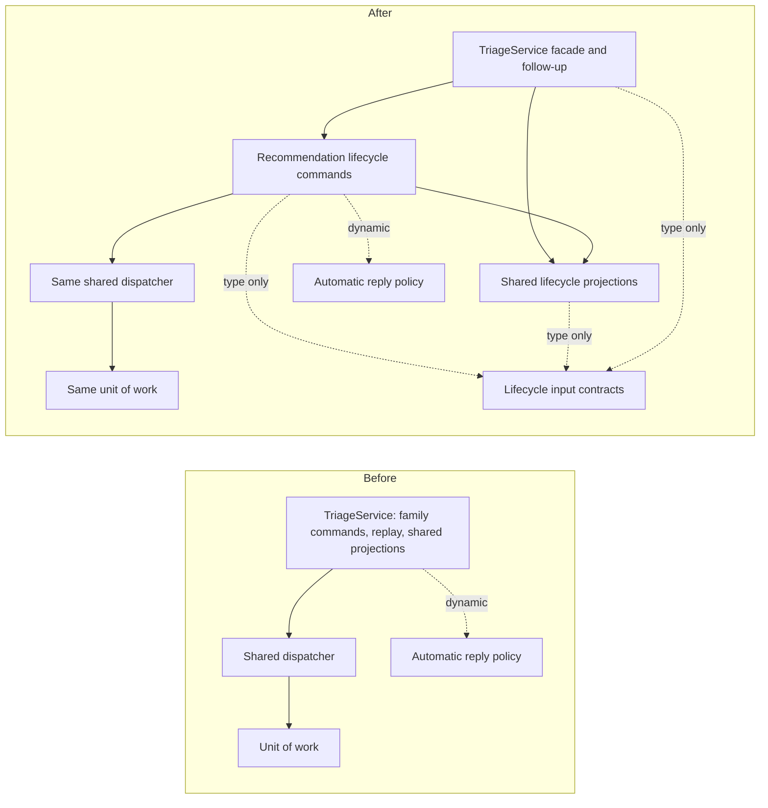

# Recommendation lifecycle contract and verification matrix

Baseline: main cc42b5c3d6e1f3f260005cd8966d006a7cc208c2. PR #35's S2/M2/M4 sequence is background; this family does not require moving the diagnosis schema. The facade retains legacy file-backed behavior and post-command automatic-reply orchestration. All checks below refer to the operational path unless stated.

| Invariant | Evidence and coverage | Gap addressed |
| --- | --- | --- |
| A human explicitly confirms approval; only selected fields and permissible overrides are applied, and a sent response must match the approved response. | ApprovalSchema and policy validation; triage-operational-recommendation-lifecycle gates and field-override cases; HTTP/MCP input validation. | Preserve rejection before writes. |
| Commit rechecks pending/approved state, ticket and source revision, and causally newer customer replies. | Lifecycle stale revision, reply, response and transition tests; transaction-local snapshot. | Preserve stale error and unchanged snapshot. |
| Parsed semantic intent and operation form the v2 request hash; generated timestamps are excluded as defined. Same-key requests join within one dispatcher, changed intent conflicts, persisted v2 receipts replay across restart; v1 receipts refuse automatic replay. | operational-command-dispatch and reliability-command-replay/lifecycle-replay, operational-recovery suites. | Lifecycle-specific concurrent approval and conflicting reuse characterization. |
| Unit of work allocates ordered events, writes aggregate, revisions, canonical message and trace, persists validated result references and commits atomically. Failure rolls all back, including receipt. | lifecycle suite and operational store; reliability-command-replay receipt failure test. | Combined approval/send receipt failure and retry characterization. |
| Replay resolves immutable historical references and original ticket snapshot; missing or inconsistent references fail closed. HTTP/MCP may assemble additional lifecycle data from current reads, so full transport envelopes need not be immutable. | reliability-lifecycle-replay tamper tests; reliability-command-replay; HTTP and MCP adapter reads. | Keep projection and replay with the command implementation. |
| Automatic reply enablement belongs to command intent; parent result records deterministic child intent and original basis. Facade runs the child after parent commit and replay can resume it. Direct markResponseSent does not itself run the child. | reliability-lifecycle-replay intent, tampering and recovery cases; lifecycle composed case. | Preserve post-command behavior and derived identity. |

Implementation plan: (1) Run characterization on the unmodified implementation and commit it with this matrix. (2) Extract the operational family together with its commit/replay logic using the existing dispatcher and narrowly typed dependencies; leave facade orchestration and compatibility path intact. (3) Run targeted suites and CI-equivalent full validation, inspect dependency graph and request independent review. (4) Commit, push, and open a draft PR only after evidence is available.
## Dependency comparison

The PR #35 TypeScript AST import analysis was run against main `cc42b5c` and this extraction. It counts explicit static import/export declarations, distinguishes type-only edges, and excludes dynamic imports from strongly connected components. Source-to-source declaration edges changed from 667 to 691 as the family was separated. Both snapshots have zero static value-import strongly connected components. The pre-existing type-inclusive component containing `triage-service.ts` has the same 13 members; the new modules do not join it. The two automatic-reply dynamic imports moved with the command implementation and are outside that static SCC calculation.

The facade retains the legacy path and runs the automatic-reply child after its parent command. The family module owns operation identities, preparation, commit, immutable replay and transition choices. The neutral support module also serves other lifecycle families and preserves the existing facade re-exports.
