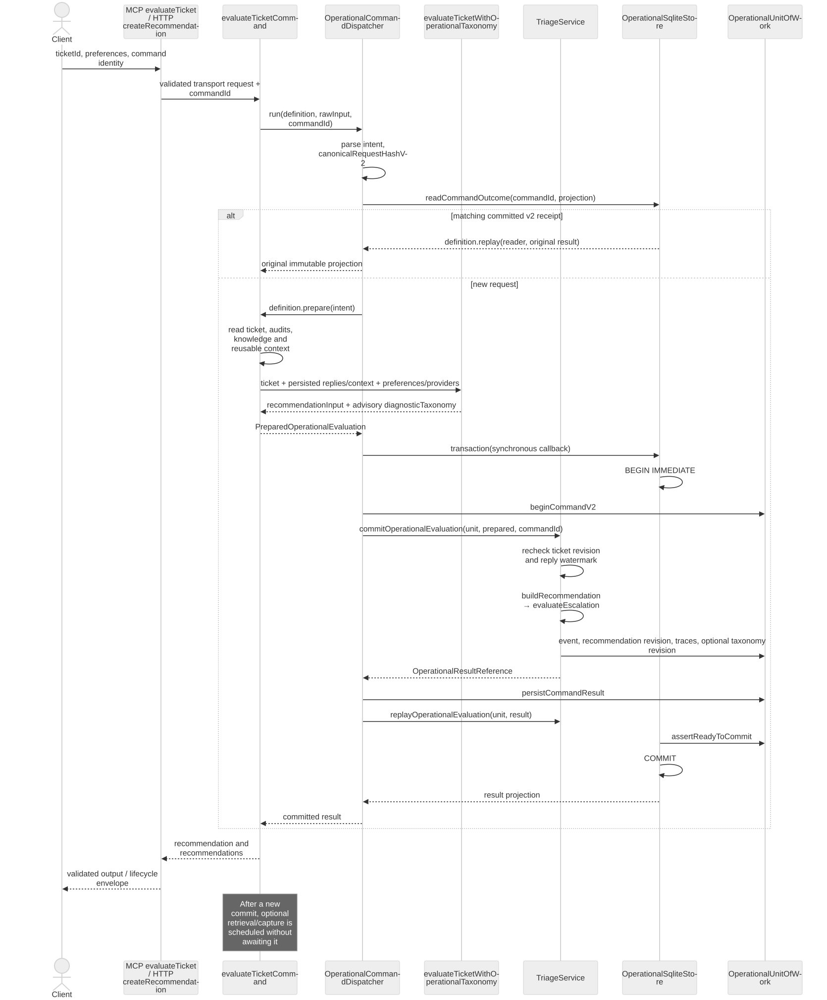
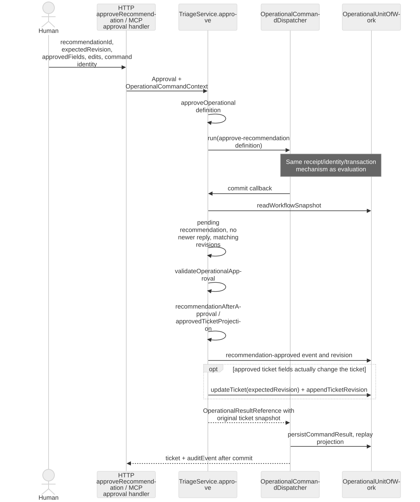
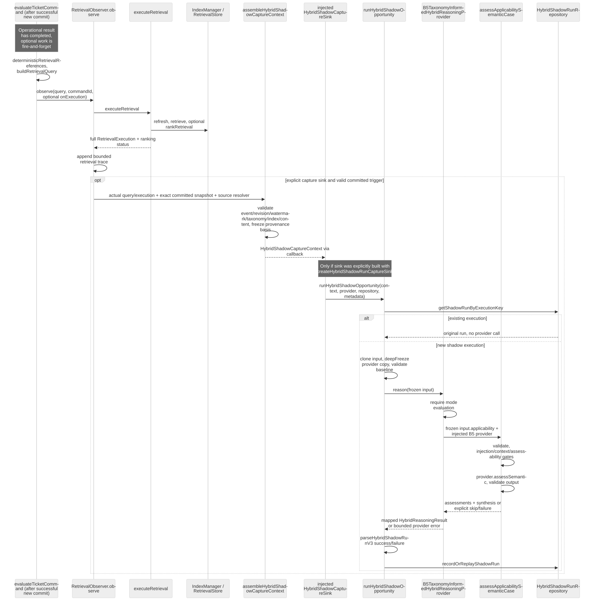

# Rendered architecture diagrams

[Report index](../README.md) · [Rendering and publication checks](../evidence/publication.json)

These portable SVGs are generated from the nine Mermaid blocks in the report. The blocks remain the editable source of truth. Open an SVG directly to zoom into long sequence diagrams. Rendering verifies presentation, not completeness of runtime reconstruction or diagnostic value.

## Module dependencies

[Mermaid source](../module-map.md) · [Full-size SVG](module-dependencies.svg)

## Retrieval and shadow dependencies

[Mermaid source](../module-map.md) · [Full-size SVG](retrieval-shadow-dependencies.svg)

## Runtime import cycle

[Mermaid source](../module-map.md) · [Full-size SVG](runtime-import-cycle.svg)

## Operational ticket evaluation

[Mermaid source](../execution-flows.md) · [Full-size SVG](operational-evaluation.svg)

## Classification and preparation

[Mermaid source](../execution-flows.md) · [Full-size SVG](classification-preparation.svg)

## Human approval

[Mermaid source](../execution-flows.md) · [Full-size SVG](human-approval.svg)

## Optional HYBRID shadow execution

[Mermaid source](../execution-flows.md) · [Full-size SVG](hybrid-shadow-execution.svg)

## Experimental E1a comparison

[Mermaid source](../execution-flows.md) · [Full-size SVG](e1a-comparison.svg)

## Data flow and state ownership

[Mermaid source](../execution-flows.md) · [Full-size SVG](state-ownership.svg)

