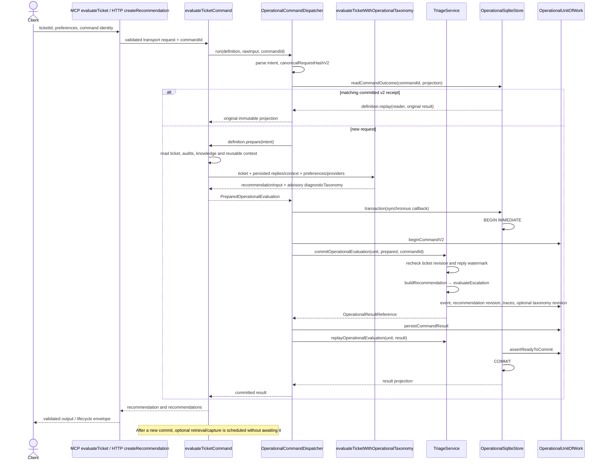
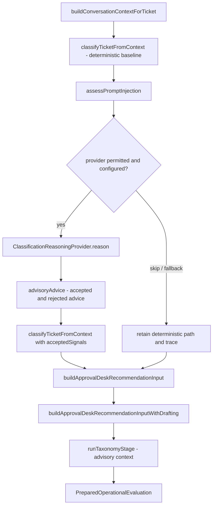
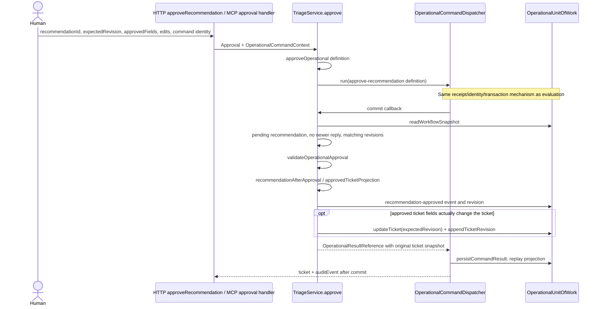
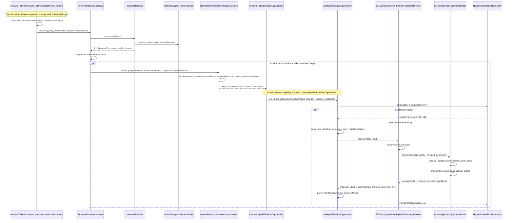
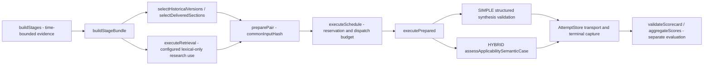
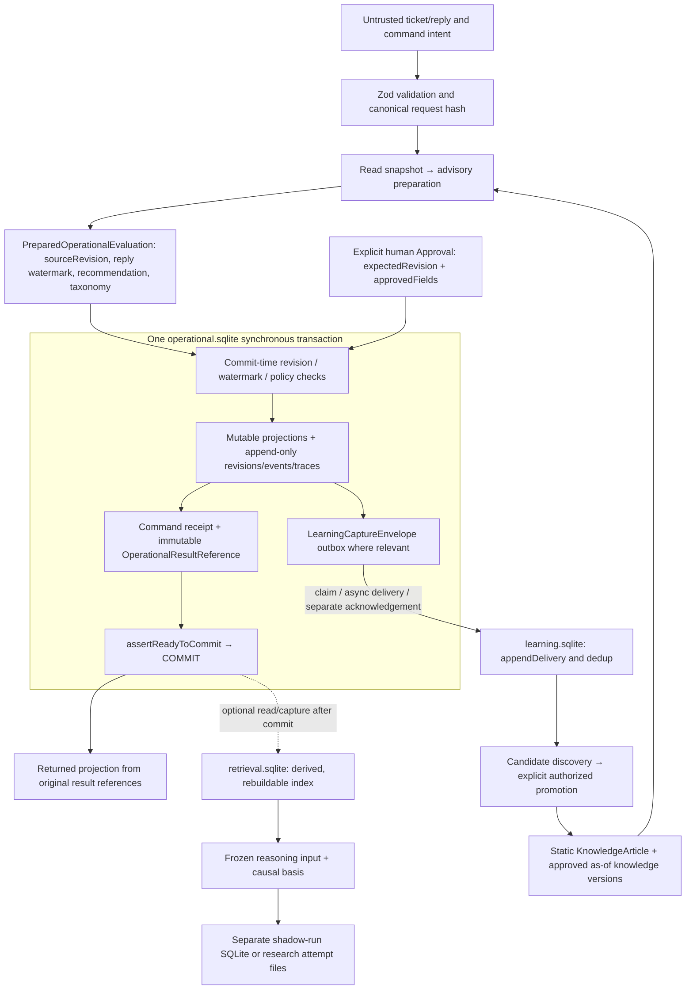

# Verified execution and data flows

[Report index](README.md) · [Module map](module-map.md) · [Debt register](technical-debt.md)

These are **manually reviewed execution paths** at public main `fe035ee…`, not generated runtime traces. Solid sequence arrows name calls found in source. Optional callbacks, injected interfaces and asynchronous post-commit work are labeled. Alternative legacy/research paths are described separately. Static imports alone were not used to infer these sequences.

## Operational ticket evaluation

MCP tool `evaluate_ticket` reaches `server.ts`'s `evaluateTicket`; HTTP recommendation creation reaches `http.ts`'s `createRecommendation`. Both use `evaluateTicketCommand` when the runtime supplies an operational dispatcher. HTTP uses `Idempotency-Key`; MCP passes `commandId`. See [src/server.ts:779](https://github.com/MatiasLaukka/Support-Ticket-Triage-MCP/blob/fe035ee383b6f9df1869104f8a623609d025023b/src/server.ts#L779), [src/server.ts:1153](https://github.com/MatiasLaukka/Support-Ticket-Triage-MCP/blob/fe035ee383b6f9df1869104f8a623609d025023b/src/server.ts#L1153), [src/approval-desk/http.ts:924](https://github.com/MatiasLaukka/Support-Ticket-Triage-MCP/blob/fe035ee383b6f9df1869104f8a623609d025023b/src/approval-desk/http.ts#L924), [src/approval-desk/http.ts:1693](https://github.com/MatiasLaukka/Support-Ticket-Triage-MCP/blob/fe035ee383b6f9df1869104f8a623609d025023b/src/approval-desk/http.ts#L1693).

[Open rendered SVG](diagrams/operational-evaluation.svg)

The diagram omits the second receipt check's race branch: `beginCommandV2` can discover another process already committed after preparation, in which case the dispatcher replays without a second write set. Same-process concurrent requests with the same identity join the in-flight promise; changed intent conflicts. Cross-process duplicate **provider preparation** remains possible before one commit wins ([src/operational-command-dispatch.ts:49](https://github.com/MatiasLaukka/Support-Ticket-Triage-MCP/blob/fe035ee383b6f9df1869104f8a623609d025023b/src/operational-command-dispatch.ts#L49), [src/operational-command-dispatch.ts:91](https://github.com/MatiasLaukka/Support-Ticket-Triage-MCP/blob/fe035ee383b6f9df1869104f8a623609d025023b/src/operational-command-dispatch.ts#L91)). This is not exactly-once provider execution.

Preparation is protected by `TicketEvaluationGuard` where supplied, but the authoritative freshness checks are inside `commitOperationalEvaluation`. A reply arriving during provider work invalidates the prepared watermark and causes rollback, rather than silently committing an old evaluation ([src/triage-service.ts:1083](https://github.com/MatiasLaukka/Support-Ticket-Triage-MCP/blob/fe035ee383b6f9df1869104f8a623609d025023b/src/triage-service.ts#L1083)). An evaluation does not itself change ticket routing fields: it persists a pending recommendation, event/revisions/traces and possibly an advisory taxonomy revision; its result's `resultingRevision` is null ([src/triage-service.ts:1122](https://github.com/MatiasLaukka/Support-Ticket-Triage-MCP/blob/fe035ee383b6f9df1869104f8a623609d025023b/src/triage-service.ts#L1122)).

The immutable recovery promise applies to the stored command result projection. HTTP and MCP then assemble a lifecycle envelope from current reads, so the full transport response may include newer lifecycle state; it is not promised to be a byte-for-byte replay of an earlier HTTP or MCP response. See the adapter reads in [server.ts:1181](https://github.com/MatiasLaukka/Support-Ticket-Triage-MCP/blob/fe035ee383b6f9df1869104f8a623609d025023b/src/server.ts#L1181) and [http.ts:965](https://github.com/MatiasLaukka/Support-Ticket-Triage-MCP/blob/fe035ee383b6f9df1869104f8a623609d025023b/src/approval-desk/http.ts#L965).

### Classification, policy and drafting inside preparation

[Open rendered SVG](diagrams/classification-preparation.svg)

Evidence: `prepareEvaluationCore` and `runClassificationStage` ([src/approval-desk/ai-evaluation.ts:122](https://github.com/MatiasLaukka/Support-Ticket-Triage-MCP/blob/fe035ee383b6f9df1869104f8a623609d025023b/src/approval-desk/ai-evaluation.ts#L122), [src/approval-desk/ai-evaluation.ts:198](https://github.com/MatiasLaukka/Support-Ticket-Triage-MCP/blob/fe035ee383b6f9df1869104f8a623609d025023b/src/approval-desk/ai-evaluation.ts#L198)), recommendation builders ([src/approval-desk/recommendation-builder.ts:105](https://github.com/MatiasLaukka/Support-Ticket-Triage-MCP/blob/fe035ee383b6f9df1869104f8a623609d025023b/src/approval-desk/recommendation-builder.ts#L105), [src/approval-desk/recommendation-builder.ts:287](https://github.com/MatiasLaukka/Support-Ticket-Triage-MCP/blob/fe035ee383b6f9df1869104f8a623609d025023b/src/approval-desk/recommendation-builder.ts#L287)), taxonomy stage ([src/taxonomy-stage.ts:46](https://github.com/MatiasLaukka/Support-Ticket-Triage-MCP/blob/fe035ee383b6f9df1869104f8a623609d025023b/src/taxonomy-stage.ts#L46)). The baseline and provider advice are not independent competing authorities. Advice is filtered, and deterministic rules resolve the final classification; prompt-injection detection and deterministic preference skip provider use. Taxonomy inference runs after the shared recommendation preparation and is advisory. The service later recomputes escalation policy before persistence ([src/triage-service.ts:938](https://github.com/MatiasLaukka/Support-Ticket-Triage-MCP/blob/fe035ee383b6f9df1869104f8a623609d025023b/src/triage-service.ts#L938)).

The builders may recompute deterministic projections for their own inputs; this compact diagram shows conceptual stages, not an exact count of classifier invocations. `outcome` overrides are controlled evaluation inputs; the HTTP path supplies a loader only when `expectedOutcomesPath` is explicitly set. The default shared command path does not automatically load a gold oracle ([src/approval-desk/http.ts:951](https://github.com/MatiasLaukka/Support-Ticket-Triage-MCP/blob/fe035ee383b6f9df1869104f8a623609d025023b/src/approval-desk/http.ts#L951)).

### Human approval is a separate command

[Open rendered SVG](diagrams/human-approval.svg)

Evidence: [src/approval-desk/http.ts:1472](https://github.com/MatiasLaukka/Support-Ticket-Triage-MCP/blob/fe035ee383b6f9df1869104f8a623609d025023b/src/approval-desk/http.ts#L1472), [src/server.ts:888](https://github.com/MatiasLaukka/Support-Ticket-Triage-MCP/blob/fe035ee383b6f9df1869104f8a623609d025023b/src/server.ts#L888), [src/triage-service.ts:1561](https://github.com/MatiasLaukka/Support-Ticket-Triage-MCP/blob/fe035ee383b6f9df1869104f8a623609d025023b/src/triage-service.ts#L1561), [src/triage-service.ts:1935](https://github.com/MatiasLaukka/Support-Ticket-Triage-MCP/blob/fe035ee383b6f9df1869104f8a623609d025023b/src/triage-service.ts#L1935), [src/triage-service.ts:5404](https://github.com/MatiasLaukka/Support-Ticket-Triage-MCP/blob/fe035ee383b6f9df1869104f8a623609d025023b/src/triage-service.ts#L5404). Explicit field selection is necessary but not sufficient: policy and freshness still apply. Approved response text is checked as part of the approval contract. Recording a response as sent has separate methods (`markResponseSent`, `approveAndMarkResponseSent`) with additional event/message bindings. The audit does not equate a recorded sent message with delivery through a real customer mail platform.

Diagnosis lifecycle commands use the same authoritative service/transaction pattern. `reviewDiagnosis` records review with expected source/reply context; `applyDiagnosisFix`, `recordFixIneffective`, `invalidateDiagnosis`, and `closeTicket` enforce their own workflow guards. They are not downstream actions automatically executed from a HYBRID hypothesis ([src/triage-service.ts:3183](https://github.com/MatiasLaukka/Support-Ticket-Triage-MCP/blob/fe035ee383b6f9df1869104f8a623609d025023b/src/triage-service.ts#L3183), [src/triage-service.ts:3754](https://github.com/MatiasLaukka/Support-Ticket-Triage-MCP/blob/fe035ee383b6f9df1869104f8a623609d025023b/src/triage-service.ts#L3754), [src/triage-service.ts:3900](https://github.com/MatiasLaukka/Support-Ticket-Triage-MCP/blob/fe035ee383b6f9df1869104f8a623609d025023b/src/triage-service.ts#L3900), [src/triage-service.ts:4244](https://github.com/MatiasLaukka/Support-Ticket-Triage-MCP/blob/fe035ee383b6f9df1869104f8a623609d025023b/src/triage-service.ts#L4244), [src/triage-service.ts:4464](https://github.com/MatiasLaukka/Support-Ticket-Triage-MCP/blob/fe035ee383b6f9df1869104f8a623609d025023b/src/triage-service.ts#L4464)).

Relevant verification: [test/reliability-command-replay.test.ts](https://github.com/MatiasLaukka/Support-Ticket-Triage-MCP/blob/fe035ee383b6f9df1869104f8a623609d025023b/test/reliability-command-replay.test.ts) covers shared HTTP/MCP preparation, no provider calls on replay, changed-intent rejection, stale reply during prepare, receipt failure rollback and cross-runtime races. [test/triage-operational-evaluation.test.ts](https://github.com/MatiasLaukka/Support-Ticket-Triage-MCP/blob/fe035ee383b6f9df1869104f8a623609d025023b/test/triage-operational-evaluation.test.ts) covers the write set. Both were run in this audit. Approval/diagnosis lifecycle suites are mapped in the module report but were not all run.

## Optional HYBRID shadow execution on main

There is no default production HYBRID provider created by runtime startup. `RuntimeOptions.hybridShadowCaptureSink` is an optional injected interface; runtime passes it through. Retrieval mode defaults to `shadow`, but retrieval observation alone does not invoke HYBRID reasoning. [src/runtime.ts:137](https://github.com/MatiasLaukka/Support-Ticket-Triage-MCP/blob/fe035ee383b6f9df1869104f8a623609d025023b/src/runtime.ts#L137), [src/runtime.ts:80](https://github.com/MatiasLaukka/Support-Ticket-Triage-MCP/blob/fe035ee383b6f9df1869104f8a623609d025023b/src/runtime.ts#L80), [src/runtime.ts:451](https://github.com/MatiasLaukka/Support-Ticket-Triage-MCP/blob/fe035ee383b6f9df1869104f8a623609d025023b/src/runtime.ts#L451) establish these distinctions.

[Open rendered SVG](diagrams/hybrid-shadow-execution.svg)

This is an available composition of interfaces, not proof that a particular running deployment has that sink installed. It is not wired from shadow results into an operational diagnosis/approval/fix command.

Verified call sites: [src/evaluation-command.ts:198](https://github.com/MatiasLaukka/Support-Ticket-Triage-MCP/blob/fe035ee383b6f9df1869104f8a623609d025023b/src/evaluation-command.ts#L198), [src/retrieval/stage.ts:58](https://github.com/MatiasLaukka/Support-Ticket-Triage-MCP/blob/fe035ee383b6f9df1869104f8a623609d025023b/src/retrieval/stage.ts#L58), [src/retrieval/execution.ts:52](https://github.com/MatiasLaukka/Support-Ticket-Triage-MCP/blob/fe035ee383b6f9df1869104f8a623609d025023b/src/retrieval/execution.ts#L52), [src/reasoning/hybrid-shadow-capture.ts:86](https://github.com/MatiasLaukka/Support-Ticket-Triage-MCP/blob/fe035ee383b6f9df1869104f8a623609d025023b/src/reasoning/hybrid-shadow-capture.ts#L86), [src/reasoning/hybrid-shadow-runner.ts:54](https://github.com/MatiasLaukka/Support-Ticket-Triage-MCP/blob/fe035ee383b6f9df1869104f8a623609d025023b/src/reasoning/hybrid-shadow-runner.ts#L54), [src/reasoning/hybrid-shadow-runner.ts:76](https://github.com/MatiasLaukka/Support-Ticket-Triage-MCP/blob/fe035ee383b6f9df1869104f8a623609d025023b/src/reasoning/hybrid-shadow-runner.ts#L76), [src/reasoning/b5-hybrid-reasoning-provider.ts:31](https://github.com/MatiasLaukka/Support-Ticket-Triage-MCP/blob/fe035ee383b6f9df1869104f8a623609d025023b/src/reasoning/b5-hybrid-reasoning-provider.ts#L31), [src/retrieval/applicability.ts:71](https://github.com/MatiasLaukka/Support-Ticket-Triage-MCP/blob/fe035ee383b6f9df1869104f8a623609d025023b/src/retrieval/applicability.ts#L71).

Important qualifications:

* `executeRetrieval` refreshes one derived index and returns discovery plus optional B4 output. The callback receives this **same execution**, rather than rerunning retrieval for capture. Candidate content must resolve from matching index metadata. B5 receives frozen coherent evidence.
* B5 applicability is **inside** the HYBRID adapter's `reason` call. It is not a separate earlier operational stage that approves a later diagnosis. The adapter maps B5 synthesis into hypotheses, catalog-backed missing-evidence requirements and hypothesis-linked action descriptions; it leaves relationships empty where no authoritative mapping exists ([src/reasoning/b5-hybrid-reasoning-provider.ts:67](https://github.com/MatiasLaukka/Support-Ticket-Triage-MCP/blob/fe035ee383b6f9df1869104f8a623609d025023b/src/reasoning/b5-hybrid-reasoning-provider.ts#L67)). Input observations are initially empty ([src/reasoning/input-assembler.ts:30](https://github.com/MatiasLaukka/Support-Ticket-Triage-MCP/blob/fe035ee383b6f9df1869104f8a623609d025023b/src/reasoning/input-assembler.ts#L30)).
* `ReasoningMode` contains `evaluation` and `diagnosis` as contract vocabulary. The inspected adapter rejects diagnosis mode before provider invocation. A mode enum value does not establish runtime support ([src/reasoning/types.ts:18](https://github.com/MatiasLaukka/Support-Ticket-Triage-MCP/blob/fe035ee383b6f9df1869104f8a623609d025023b/src/reasoning/types.ts#L18)).
* Capture failures and observer failures are reported as bounded diagnostics and do not roll back an already committed command. The post-commit path catches sink errors. Direct callers of the runner still see repository/invalid-context errors; provider errors are captured as failed runs ([src/evaluation-command.ts:296](https://github.com/MatiasLaukka/Support-Ticket-Triage-MCP/blob/fe035ee383b6f9df1869104f8a623609d025023b/src/evaluation-command.ts#L296), [src/reasoning/hybrid-shadow-runner.ts:76](https://github.com/MatiasLaukka/Support-Ticket-Triage-MCP/blob/fe035ee383b6f9df1869104f8a623609d025023b/src/reasoning/hybrid-shadow-runner.ts#L76)).
* An existing shadow execution key prevents another provider call on sequential replay. Two concurrent fresh shadow calls can both reach a provider before append/replay arbitration; the repository's uniqueness guarantee is a persistence guarantee. Do not infer a provider-level exactly-once promise from the unique index.

Fresh focused checks ran `hybrid-reasoning-input`, `hybrid-shadow-capture`, `hybrid-shadow-runner`, `hybrid-shadow-run-sqlite`, `b5-hybrid-reasoning-provider`, `retrieval-applicability` and `retrieval-ranking` tests. These verify contracts with synthetic/injected transports; they do not evaluate diagnostic value.

## Experimental SIMPLE/HYBRID comparison is another path

**E1a overlay only**, observed at `research/home-assistant-e1a`, HEAD `6a60fdd…` plus dirty working files. The source hashes and tracked changes are recorded in [baseline evidence](evidence/baseline.json). These functions are not available in the delivery checkout or established as public main interfaces.

[Open rendered SVG](diagrams/e1a-comparison.svg)

Verified overlay references (links open retained provenance records; research source contents are not published): [scripts/home-assistant-e1a/inputs.ts:116](evidence/research-source-index.md#inputs) (`buildStages`), `:152` (`selectHistoricalVersions`), `:200` (`selectDeliveredSections`), `:242` (`buildStageBundle`); [scripts/home-assistant-e1a/runners.ts:152](evidence/research-source-index.md#runners) (`preparePair`), `:349` (`executePrepared`), `:455` (`executeSchedule`); [scripts/home-assistant-e1a/results.ts:39](evidence/research-source-index.md#results) (`createAttemptStore`); [scripts/home-assistant-e1a/evaluation.ts:48](evidence/research-source-index.md#evaluation) / `:100` (`validateScorecard`, `aggregateScores`).

This runner uses B5 semantics directly for its HYBRID lane and a distinct SIMPLE output validator. It does **not** run every attempt through `runHybridShadowOpportunity` or the generic shadow SQLite repository. Attempt files are create-only (`openSync(..., "wx")` plus flush), with reservation/dispatch/transport/terminal phases. Research SIMPLE is a comparison lane name, not the same interface as the operational deterministic classifier. A valid output or completed transport is not a correct diagnosis. No comparison, scoring, gold access, or provider invocation was performed here.

The E1a source adds preflight helpers, exported mapping, different provider/semantic schemas, and a text-focused retrieval query interface in six `src` files compared with main. Preserve these as experimental deltas until separately reviewed; do not copy them wholesale into operational runtime.

## Data flow, state ownership and transactions

[Open rendered SVG](diagrams/state-ownership.svg)

Dashed edge is an optional observation relationship. Other arrows here show **data transfer**, not imports. The shadow store has no return arrow granting mutation authority to the operational transaction. Some lifecycle operations produce learning outbox envelopes; ordinary ticket evaluation should not be read as unconditionally writing an outbox row.

| Significant data / fields | Origin and lifecycle | Owner and invariant |
|---|---|---|
| `Ticket.id`, `Ticket.revision` | Validated seed/import/current ticket; reads become preparation inputs; approved changes may append a new revision | Operational store owns mutable ticket projection and historical ticket revisions. Caller `expectedRevision` / recommendation `sourceRevision` must match current state at commit. [src/operational/unit-of-work.ts:642](https://github.com/MatiasLaukka/Support-Ticket-Triage-MCP/blob/fe035ee383b6f9df1869104f8a623609d025023b/src/operational/unit-of-work.ts#L642), [src/triage-service.ts:1088](https://github.com/MatiasLaukka/Support-Ticket-Triage-MCP/blob/fe035ee383b6f9df1869104f8a623609d025023b/src/triage-service.ts#L1088), [src/triage-service.ts:1970](https://github.com/MatiasLaukka/Support-Ticket-Triage-MCP/blob/fe035ee383b6f9df1869104f8a623609d025023b/src/triage-service.ts#L1970). |
| Customer reply watermark | Derived from persisted audits or canonical operational messages, not arbitrary wall-clock freshness | Evaluation preparation captures it; commit rejects new replies; diagnosis/review contexts retain it. [src/triage-service.ts:663](https://github.com/MatiasLaukka/Support-Ticket-Triage-MCP/blob/fe035ee383b6f9df1869104f8a623609d025023b/src/triage-service.ts#L663), [src/triage-service.ts:679](https://github.com/MatiasLaukka/Support-Ticket-Triage-MCP/blob/fe035ee383b6f9df1869104f8a623609d025023b/src/triage-service.ts#L679). A supplied inline reply is input context, not automatically a persisted customer message. |
| `PreparedOperationalEvaluation` | Contains serializable recommendation input, advisory taxonomy and evaluated reply watermark; classifier confidence carried separately | Application preparation owns the temporary object. It is not a trusted persisted result until service validation and transaction commit. [src/triage-service.ts:422](https://github.com/MatiasLaukka/Support-Ticket-Triage-MCP/blob/fe035ee383b6f9df1869104f8a623609d025023b/src/triage-service.ts#L422), [src/evaluation-command.ts:168](https://github.com/MatiasLaukka/Support-Ticket-Triage-MCP/blob/fe035ee383b6f9df1869104f8a623609d025023b/src/evaluation-command.ts#L168). |
| `TriageRecommendation` | Created pending with `sourceRevision`; resolution transitions append revisions, not new authority from a model | Operational unit writes projection/history. Approval allows selected fields only and respects newer-reply/terminal-state policy. [src/triage-service.ts:853](https://github.com/MatiasLaukka/Support-Ticket-Triage-MCP/blob/fe035ee383b6f9df1869104f8a623609d025023b/src/triage-service.ts#L853), [src/triage-service.ts:1935](https://github.com/MatiasLaukka/Support-Ticket-Triage-MCP/blob/fe035ee383b6f9df1869104f8a623609d025023b/src/triage-service.ts#L1935). |
| Command identity | `commandId`, operation, normalized intent, `requestHashVersion`, `requestHash` | Parsed semantic identity excludes generated fields where command definitions specify. v2 receipt/result is immutable; mismatched reuse conflicts; v1 automatically rejects. [src/operational-command-dispatch.ts:49](https://github.com/MatiasLaukka/Support-Ticket-Triage-MCP/blob/fe035ee383b6f9df1869104f8a623609d025023b/src/operational-command-dispatch.ts#L49), [src/operational/idempotency.ts](https://github.com/MatiasLaukka/Support-Ticket-Triage-MCP/blob/fe035ee383b6f9df1869104f8a623609d025023b/src/operational/idempotency.ts), [src/operational/unit-of-work.ts:253](https://github.com/MatiasLaukka/Support-Ticket-Triage-MCP/blob/fe035ee383b6f9df1869104f8a623609d025023b/src/operational/unit-of-work.ts#L253). |
| `OperationalResultReference` | Stores exact event/recommendation/ticket/diagnosis/taxonomy references for the original command | Unit validates durable references; replay projects original history even after current ticket state advances. It must not recalculate model output or silently reinterpret an old receipt. [src/operational/unit-of-work.ts:334](https://github.com/MatiasLaukka/Support-Ticket-Triage-MCP/blob/fe035ee383b6f9df1869104f8a623609d025023b/src/operational/unit-of-work.ts#L334), [src/operational/unit-of-work.ts:1755](https://github.com/MatiasLaukka/Support-Ticket-Triage-MCP/blob/fe035ee383b6f9df1869104f8a623609d025023b/src/operational/unit-of-work.ts#L1755). |
| `OperationalEvent.sequence`, message event binding | Ticket-wide causal ordering allocated within transaction | Event sequence identifies operational order; canonical event/message pairs prevent projections from inventing conversation facts. Timestamps describe occurrences, not complete causal order. [src/operational/unit-of-work.ts:611](https://github.com/MatiasLaukka/Support-Ticket-Triage-MCP/blob/fe035ee383b6f9df1869104f8a623609d025023b/src/operational/unit-of-work.ts#L611), [src/approval-desk/workflow-causal-context.ts:25](https://github.com/MatiasLaukka/Support-Ticket-Triage-MCP/blob/fe035ee383b6f9df1869104f8a623609d025023b/src/approval-desk/workflow-causal-context.ts#L25). |
| Diagnosis/review/fix and impact | Service checks diagnosis context, evidence/review basis and scoped impact before mutation | Operational diagnosis/event/review records carry authority. A shadow hypothesis ID or relative rank is not a diagnosis ID or approval. [src/triage-service.ts:3365](https://github.com/MatiasLaukka/Support-Ticket-Triage-MCP/blob/fe035ee383b6f9df1869104f8a623609d025023b/src/triage-service.ts#L3365), [src/triage-service.ts:4483](https://github.com/MatiasLaukka/Support-Ticket-Triage-MCP/blob/fe035ee383b6f9df1869104f8a623609d025023b/src/triage-service.ts#L4483). |
| `LearningCaptureEnvelope`, claim token, delivery identity | Immutable semantic envelope written with authoritative event; mutable outbox claim/delivery status | Claim transaction → learning append/dedup → acknowledgement transaction. Retry after learning commit can return duplicate without duplicating ledger facts. No cross-DB ACID claim. [src/operational/learning-outbox.ts:101](https://github.com/MatiasLaukka/Support-Ticket-Triage-MCP/blob/fe035ee383b6f9df1869104f8a623609d025023b/src/operational/learning-outbox.ts#L101), [src/knowledge-evolution/sqlite-learning-ledger.ts:116](https://github.com/MatiasLaukka/Support-Ticket-Triage-MCP/blob/fe035ee383b6f9df1869104f8a623609d025023b/src/knowledge-evolution/sqlite-learning-ledger.ts#L116). |
| `KnowledgeCandidate.version`, object/version/head, evidence policy | Candidate proposed, reviewed, explicitly promoted; replacements require expected candidate/head versions | `learning.sqlite` object/version store commits promotion audit, version/head transition and learning events together. Approved reusable context is a filtered, frozen as-of projection, not arbitrary candidate data. [src/knowledge-evolution/service.ts:217](https://github.com/MatiasLaukka/Support-Ticket-Triage-MCP/blob/fe035ee383b6f9df1869104f8a623609d025023b/src/knowledge-evolution/service.ts#L217), [src/knowledge-evolution/sqlite-knowledge-evolution-store.ts:191](https://github.com/MatiasLaukka/Support-Ticket-Triage-MCP/blob/fe035ee383b6f9df1869104f8a623609d025023b/src/knowledge-evolution/sqlite-knowledge-evolution-store.ts#L191), [src/knowledge-evolution/reusable-context.ts:68](https://github.com/MatiasLaukka/Support-Ticket-Triage-MCP/blob/fe035ee383b6f9df1869104f8a623609d025023b/src/knowledge-evolution/reusable-context.ts#L68). |
| `Query.queryText`, `queryHash`, `sourceRevision`, reply watermark | Query text clipped from customer-authored context; hash covers source subject/description and ordered reply identities/bodies | Transient text feeds retrieval. Bounded traces retain identities/results rather than raw query text. Query hash alone is not the entire freshness identity; source revision/watermark accompany it. [src/retrieval/stage.ts:17](https://github.com/MatiasLaukka/Support-Ticket-Triage-MCP/blob/fe035ee383b6f9df1869104f8a623609d025023b/src/retrieval/stage.ts#L17). |
| Index metadata, generation / semantic generation, source hashes | Derived retrieval source snapshot; refreshed under index manager | Retrieval store owns disposable indexed resources and vectors. A partial/stale/unavailable semantic channel remains explicit; content resolution for shadow capture must match execution metadata. [src/retrieval/search.ts:14](https://github.com/MatiasLaukka/Support-Ticket-Triage-MCP/blob/fe035ee383b6f9df1869104f8a623609d025023b/src/retrieval/search.ts#L14), [src/reasoning/hybrid-shadow-capture.ts:125](https://github.com/MatiasLaukka/Support-Ticket-Triage-MCP/blob/fe035ee383b6f9df1869104f8a623609d025023b/src/reasoning/hybrid-shadow-capture.ts#L125). |
| `HybridShadowBasis` | Event ID/sequence, committed-through sequence, ticket/reply/taxonomy revisions and query hash | Capture validates one causal basis and source content, then clones data. Branded opportunity ID binds the opportunity; runner execution key also binds provider/model/semantic contract. [src/reasoning/hybrid-shadow-capture.ts:186](https://github.com/MatiasLaukka/Support-Ticket-Triage-MCP/blob/fe035ee383b6f9df1869104f8a623609d025023b/src/reasoning/hybrid-shadow-capture.ts#L186), [src/reasoning/hybrid-shadow-runner.ts:168](https://github.com/MatiasLaukka/Support-Ticket-Triage-MCP/blob/fe035ee383b6f9df1869104f8a623609d025023b/src/reasoning/hybrid-shadow-runner.ts#L168). |
| `HybridReasoningInput` / `HybridReasoningResult` | Provider receives a recursively frozen clone; output is validated against versioned run contract | Shadow store appends immutable success/failure; adapter result has advisory hypotheses/actions, no operational mutation permission. [src/reasoning/hybrid-shadow-runner.ts:110](https://github.com/MatiasLaukka/Support-Ticket-Triage-MCP/blob/fe035ee383b6f9df1869104f8a623609d025023b/src/reasoning/hybrid-shadow-runner.ts#L110), [src/reasoning/types.ts:99](https://github.com/MatiasLaukka/Support-Ticket-Triage-MCP/blob/fe035ee383b6f9df1869104f8a623609d025023b/src/reasoning/types.ts#L99). |

## Error and recovery map

| Boundary | Behavior / uncertainty |
|---|---|
| Transport | Zod and command errors become bounded HTTP status/body or MCP `isError`. Unknown errors produce safe public text; internal diagnostics are separate. [src/approval-desk/http.ts:1789](https://github.com/MatiasLaukka/Support-Ticket-Triage-MCP/blob/fe035ee383b6f9df1869104f8a623609d025023b/src/approval-desk/http.ts#L1789), [src/server.ts:1657](https://github.com/MatiasLaukka/Support-Ticket-Triage-MCP/blob/fe035ee383b6f9df1869104f8a623609d025023b/src/server.ts#L1657), [src/command-errors.ts](https://github.com/MatiasLaukka/Support-Ticket-Triage-MCP/blob/fe035ee383b6f9df1869104f8a623609d025023b/src/command-errors.ts). |
| Optional classification/drafting/taxonomy | Explicit stage fallback or skip; deterministic policy remains applied. This is different from silent provider/model switching in research evaluation. |
| Operational transaction | Rejects asynchronous callback and Promise result, maps SQLite lock failures, rolls back and closes unit scope. Receipt failure cannot leave a successful write set. [src/operational/sqlite-store.ts:131](https://github.com/MatiasLaukka/Support-Ticket-Triage-MCP/blob/fe035ee383b6f9df1869104f8a623609d025023b/src/operational/sqlite-store.ts#L131). |
| Learning availability | Operational command and its outbox can persist even when learning is unavailable. Delivery retries/dead letters are explicit; promotion is separately authorized. |
| Retrieval/capture | Runtime/observer convert faults to advisory unavailability/diagnostics; ranking has explicit success/failure/not-requested status. The underlying store still validates integrity. Shutdown aborts observation and waits for active work before closing resources. |
| Shadow runner | Provider failures become bounded failed runs; invalid context/store identity can throw to shadow caller; post-commit callback contains those errors. Failed outputs remain evidence, not discarded successes. |

Three mechanisms called replay must stay separate: operational receipt recovery, synthetic lifecycle/evaluation replay, and shadow execution/attempt replay. Their inputs, authority and persistence contracts are different.
