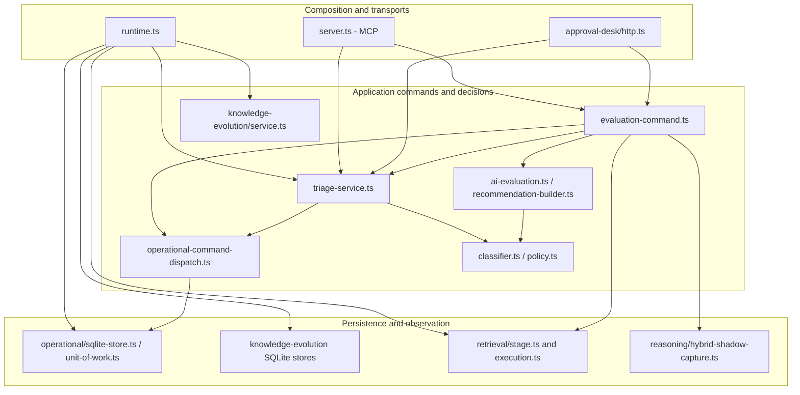
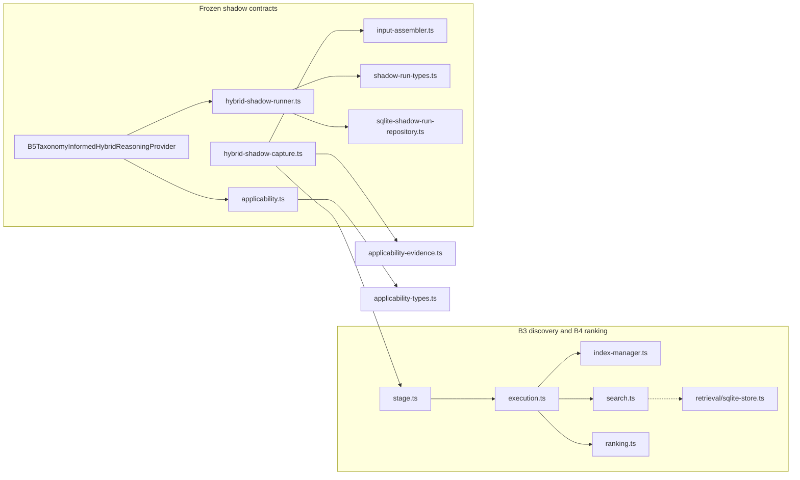
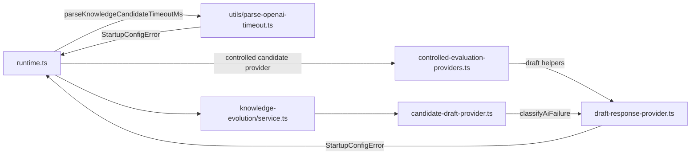

# Module map and dependency direction

[Report index](README.md) · [Execution flows](execution-flows.md) · [Debt register](technical-debt.md)

Baseline: public main `fe035ee383b6f9df1869104f8a623609d025023b`. Responsibilities below are manually reviewed; imports and declarations are generated in [imports.tsv](evidence/imports.tsv) and [symbols.tsv](evidence/symbols.tsv). The symbol inventory is a navigation index, not a claim that every export is public to external clients.

## Overview: direct source dependencies, grouped for reading

Solid arrows mean an explicit value import from a file in the first group to a file in the second; dashed arrows here mean explicit type-only dependency. These are **dependency arrows**, not execution order or a claim that every function in a group calls the other group. Supporting edges are in the generated inventory. Transitive relationships and some secondary dependencies are omitted for readability.

[Open rendered SVG](diagrams/module-dependencies.svg)

`D → O` is specifically the runtime error class imported from `unit-of-work.ts`; the dispatcher receives the store structurally through `DispatchableOperationalStore`, rather than constructing SQLite itself. `R` supplies implementations. This distinction matters when testing with an adapter at the same interface.

## Operational responsibilities and interfaces

| Module / source evidence | Responsibility and important interface | Direct dependencies and ownership | Effects, errors and behavioral evidence |
|---|---|---|---|
| [src/index.ts:24](https://github.com/MatiasLaukka/Support-Ticket-Triage-MCP/blob/fe035ee383b6f9df1869104f8a623609d025023b/src/index.ts#L24), [src/approval-desk.ts:71](https://github.com/MatiasLaukka/Support-Ticket-Triage-MCP/blob/fe035ee383b6f9df1869104f8a623609d025023b/src/approval-desk.ts#L71) | Executable composition: `main`, connect/listen, signals and shutdown | `createRuntimeDependencies`, MCP transport or HTTP factory; process owns runtime lifetime | Opens transports and handles startup/cleanup errors. [test/entrypoint.test.ts](https://github.com/MatiasLaukka/Support-Ticket-Triage-MCP/blob/fe035ee383b6f9df1869104f8a623609d025023b/test/entrypoint.test.ts), [test/approval-desk-entrypoint.test.ts](https://github.com/MatiasLaukka/Support-Ticket-Triage-MCP/blob/fe035ee383b6f9df1869104f8a623609d025023b/test/approval-desk-entrypoint.test.ts). |
| [src/runtime.ts:238](https://github.com/MatiasLaukka/Support-Ticket-Triage-MCP/blob/fe035ee383b6f9df1869104f8a623609d025023b/src/runtime.ts#L238) | `createRuntimeDependencies`, `RuntimeOptions`, `RuntimeDependencies`; parse explicit environment settings and select adapters | Directly creates operational, learning and retrieval stores, `TriageService`, knowledge service, outbox worker/runner; optional injected capture sink | Owns handles, demo-state usage lease and idempotent `close`. Learning/retrieval can be unavailable without removing operational authority. [test/runtime.test.ts](https://github.com/MatiasLaukka/Support-Ticket-Triage-MCP/blob/fe035ee383b6f9df1869104f8a623609d025023b/test/runtime.test.ts), [test/runtime-learning-delivery.test.ts](https://github.com/MatiasLaukka/Support-Ticket-Triage-MCP/blob/fe035ee383b6f9df1869104f8a623609d025023b/test/runtime-learning-delivery.test.ts), [test/retrieval-runtime.test.ts](https://github.com/MatiasLaukka/Support-Ticket-Triage-MCP/blob/fe035ee383b6f9df1869104f8a623609d025023b/test/retrieval-runtime.test.ts). |
| [src/server.ts:522](https://github.com/MatiasLaukka/Support-Ticket-Triage-MCP/blob/fe035ee383b6f9df1869104f8a623609d025023b/src/server.ts#L522) | `createTriageServer`; MCP tool/resource schemas and handlers; evaluation, approval, diagnosis/review/fix and knowledge tools | Imports command, service, read models, repositories, policy-related projection helpers; receives dependencies | MCP input/output validation and safe tool errors (`toolResult`). Tool `approve_triage_recommendation` passes explicit approval fields to the service; tools do not constitute user approval by themselves. [test/server-read.test.ts](https://github.com/MatiasLaukka/Support-Ticket-Triage-MCP/blob/fe035ee383b6f9df1869104f8a623609d025023b/test/server-read.test.ts), [test/server-actions.test.ts](https://github.com/MatiasLaukka/Support-Ticket-Triage-MCP/blob/fe035ee383b6f9df1869104f8a623609d025023b/test/server-actions.test.ts), [test/recovery-transports.test.ts](https://github.com/MatiasLaukka/Support-Ticket-Triage-MCP/blob/fe035ee383b6f9df1869104f8a623609d025023b/test/recovery-transports.test.ts). |
| [src/approval-desk/http.ts:339](https://github.com/MatiasLaukka/Support-Ticket-Triage-MCP/blob/fe035ee383b6f9df1869104f8a623609d025023b/src/approval-desk/http.ts#L339) | `createApprovalDeskHttpServer`, `routeRequest`, `matchRoute`, `createRecommendation`, `approveRecommendation` | Runtime dependencies by type, command function, service, workflow/lifecycle read models, UI template | HTTP validation, body limits, required command context for operational mutations, status/error mapping. Owns no authoritative ticket state. [test/approval-desk-http.test.ts](https://github.com/MatiasLaukka/Support-Ticket-Triage-MCP/blob/fe035ee383b6f9df1869104f8a623609d025023b/test/approval-desk-http.test.ts), [test/approval-desk-retry.test.ts](https://github.com/MatiasLaukka/Support-Ticket-Triage-MCP/blob/fe035ee383b6f9df1869104f8a623609d025023b/test/approval-desk-retry.test.ts), [test/reliability-command-replay.test.ts](https://github.com/MatiasLaukka/Support-Ticket-Triage-MCP/blob/fe035ee383b6f9df1869104f8a623609d025023b/test/reliability-command-replay.test.ts). |
| [src/evaluation-command.ts:98](https://github.com/MatiasLaukka/Support-Ticket-Triage-MCP/blob/fe035ee383b6f9df1869104f8a623609d025023b/src/evaluation-command.ts#L98) | Shared `evaluateTicketCommand`, `EvaluationCommandInputSchema`, `EvaluationCommandDependencies`; prepare once, commit or replay, optional post-commit observation | Dispatcher; AI evaluation; providers; audit/reply projections; retrieval query and shadow capture assembly. the `TriageService` class is referenced by type, while watermark helper imports create a value dependency on its module | Reads snapshots/knowledge; provider work happens in prepare, outside the SQL write transaction. Captures ticket revision and reply watermark, serializes prepared input. New commit schedules optional shadow observation; replay does not re-run prepare. [test/reliability-command-replay.test.ts](https://github.com/MatiasLaukka/Support-Ticket-Triage-MCP/blob/fe035ee383b6f9df1869104f8a623609d025023b/test/reliability-command-replay.test.ts), [test/hybrid-shadow-capture.test.ts](https://github.com/MatiasLaukka/Support-Ticket-Triage-MCP/blob/fe035ee383b6f9df1869104f8a623609d025023b/test/hybrid-shadow-capture.test.ts). |
| [src/operational-command-dispatch.ts:17](https://github.com/MatiasLaukka/Support-Ticket-Triage-MCP/blob/fe035ee383b6f9df1869104f8a623609d025023b/src/operational-command-dispatch.ts#L17) | `PreparedCommandDefinition<I,P,R>` and `OperationalCommandDispatcher.run`; parsed intent → prepare → synchronous commit → immutable replay projection | `canonicalRequestHashV2`; structural store/reader; error type from unit of work. Owns a per-dispatcher in-flight map, not durable state | Same key/same intent joins or replays; different intent conflicts; v1 receipt rejected as `LEGACY_REPLAY_UNAVAILABLE`. Separate processes may both prepare; only one write set commits. [test/operational-command-dispatch.test.ts](https://github.com/MatiasLaukka/Support-Ticket-Triage-MCP/blob/fe035ee383b6f9df1869104f8a623609d025023b/test/operational-command-dispatch.test.ts), [test/reliability-command-replay.test.ts](https://github.com/MatiasLaukka/Support-Ticket-Triage-MCP/blob/fe035ee383b6f9df1869104f8a623609d025023b/test/reliability-command-replay.test.ts). |
| [src/triage-service.ts:712](https://github.com/MatiasLaukka/Support-Ticket-Triage-MCP/blob/fe035ee383b6f9df1869104f8a623609d025023b/src/triage-service.ts#L712) | `TriageService`: submit/evaluate, approve/reject/cancel/send, reply, diagnosis/review/fix/mitigation/close, lifecycle replay projections. `PreparedOperationalEvaluation`, `TicketStore`, `RecommendationStore`, `AuditStore`, `OperationalCommandStore` | Domain schemas, policy, diagnostic contracts, dispatcher, operational types/errors, learning capture; lazy imports of diagnosis/workflow helpers. Owns orchestration and validation, delegates persistence | Creates write sets and result references; rechecks stale revision, reply watermark and approval state. Supports operational and file-backed fixture paths. Many private commit/replay methods are deliberately paired. [test/triage-operational-evaluation.test.ts](https://github.com/MatiasLaukka/Support-Ticket-Triage-MCP/blob/fe035ee383b6f9df1869104f8a623609d025023b/test/triage-operational-evaluation.test.ts), [test/triage-operational-recommendation-lifecycle.test.ts](https://github.com/MatiasLaukka/Support-Ticket-Triage-MCP/blob/fe035ee383b6f9df1869104f8a623609d025023b/test/triage-operational-recommendation-lifecycle.test.ts), [test/triage-operational-diagnosis-lifecycle.test.ts](https://github.com/MatiasLaukka/Support-Ticket-Triage-MCP/blob/fe035ee383b6f9df1869104f8a623609d025023b/test/triage-operational-diagnosis-lifecycle.test.ts), [test/triage-service.test.ts](https://github.com/MatiasLaukka/Support-Ticket-Triage-MCP/blob/fe035ee383b6f9df1869104f8a623609d025023b/test/triage-service.test.ts). |
| [src/approval-desk/classifier.ts:121](https://github.com/MatiasLaukka/Support-Ticket-Triage-MCP/blob/fe035ee383b6f9df1869104f8a623609d025023b/src/approval-desk/classifier.ts#L121) | `classifyTicket`, `classifyTicketFromContext`, `TicketClassification`; deterministic scoring, category/team/priority and evidence selection | Type-only ticket/context dependencies; confidence builder, known-cause and known-event catalogs. No store or provider ownership | Pure calculation from caller inputs; advisory signals are inputs, not a bypass around rule resolution. [test/classifier.test.ts](https://github.com/MatiasLaukka/Support-Ticket-Triage-MCP/blob/fe035ee383b6f9df1869104f8a623609d025023b/test/classifier.test.ts) (60 focused checks passed). |
| [src/policy.ts:39](https://github.com/MatiasLaukka/Support-Ticket-Triage-MCP/blob/fe035ee383b6f9df1869104f8a623609d025023b/src/policy.ts#L39) | `evaluateEscalation`, `validateApprovedFields`, `EscalationDecision` | Ticket/recommendation types and `DomainError`; no persistence or network | Security/outage/SLA/confidence/workflow policy and stable reason ordering. Approval checks reject missing/duplicate/unknown/unproposed fields. [test/policy.test.ts](https://github.com/MatiasLaukka/Support-Ticket-Triage-MCP/blob/fe035ee383b6f9df1869104f8a623609d025023b/test/policy.test.ts) (31 focused checks passed). |
| [src/approval-desk/ai-evaluation.ts:122](https://github.com/MatiasLaukka/Support-Ticket-Triage-MCP/blob/fe035ee383b6f9df1869104f8a623609d025023b/src/approval-desk/ai-evaluation.ts#L122) | `prepareEvaluationCore`, `runClassificationStage`, `evaluateTicketWithOperationalTaxonomy`, legacy `evaluateTicketWithAi` | Deterministic classifier, conversation context, prompt-injection assessment, recommendation builder, taxonomy stage, provider contracts | Baseline → optional provider advice → accepted signals → deterministic reclassification → drafting and advisory taxonomy. Provider failures have bounded fallback traces. [test/ai-evaluation.test.ts](https://github.com/MatiasLaukka/Support-Ticket-Triage-MCP/blob/fe035ee383b6f9df1869104f8a623609d025023b/test/ai-evaluation.test.ts), [test/classification-reasoning-provider.test.ts](https://github.com/MatiasLaukka/Support-Ticket-Triage-MCP/blob/fe035ee383b6f9df1869104f8a623609d025023b/test/classification-reasoning-provider.test.ts), [test/taxonomy-stage.test.ts](https://github.com/MatiasLaukka/Support-Ticket-Triage-MCP/blob/fe035ee383b6f9df1869104f8a623609d025023b/test/taxonomy-stage.test.ts). |
| [src/approval-desk/classification-reasoning-provider.ts:77](https://github.com/MatiasLaukka/Support-Ticket-Triage-MCP/blob/fe035ee383b6f9df1869104f8a623609d025023b/src/approval-desk/classification-reasoning-provider.ts#L77), [src/taxonomy-stage.ts:46](https://github.com/MatiasLaukka/Support-Ticket-Triage-MCP/blob/fe035ee383b6f9df1869104f8a623609d025023b/src/taxonomy-stage.ts#L46) | `ClassificationReasoningProvider.reason`, `OpenAiClassificationReasoningProvider`; `runTaxonomyStage` and `TaxonomyStageResult` | Zod/domain/schema builders, URL/timeout helpers, injected/default fetch; deterministic taxonomy in [src/taxonomy-inference.ts:155](https://github.com/MatiasLaukka/Support-Ticket-Triage-MCP/blob/fe035ee383b6f9df1869104f8a623609d025023b/src/taxonomy-inference.ts#L155) | Optional network, response/schema/telemetry normalization; deterministic fallback and explicit stage status. Taxonomy is persisted as advisory and does not rewrite the operational classification. [test/classification-reasoning-provider.test.ts](https://github.com/MatiasLaukka/Support-Ticket-Triage-MCP/blob/fe035ee383b6f9df1869104f8a623609d025023b/test/classification-reasoning-provider.test.ts), [test/taxonomy-inference.test.ts](https://github.com/MatiasLaukka/Support-Ticket-Triage-MCP/blob/fe035ee383b6f9df1869104f8a623609d025023b/test/taxonomy-inference.test.ts), [test/taxonomy-stage.test.ts](https://github.com/MatiasLaukka/Support-Ticket-Triage-MCP/blob/fe035ee383b6f9df1869104f8a623609d025023b/test/taxonomy-stage.test.ts). |
| [src/approval-desk/recommendation-builder.ts:105](https://github.com/MatiasLaukka/Support-Ticket-Triage-MCP/blob/fe035ee383b6f9df1869104f8a623609d025023b/src/approval-desk/recommendation-builder.ts#L105) | `buildApprovalDeskRecommendationInput`, drafting variant, lifecycle-aware response construction | Classifier, diagnosis/fix/workflow context, known events/causes, evidence readiness, reusable knowledge, draft contracts | Combines policy-sensitive content selection and response presentation; optional draft provider invoked through guarded interface. No SQL ownership. [test/approval-desk-recommendation.test.ts](https://github.com/MatiasLaukka/Support-Ticket-Triage-MCP/blob/fe035ee383b6f9df1869104f8a623609d025023b/test/approval-desk-recommendation.test.ts), [test/draft-contract.test.ts](https://github.com/MatiasLaukka/Support-Ticket-Triage-MCP/blob/fe035ee383b6f9df1869104f8a623609d025023b/test/draft-contract.test.ts), [test/draft-quality-guardrails.test.ts](https://github.com/MatiasLaukka/Support-Ticket-Triage-MCP/blob/fe035ee383b6f9df1869104f8a623609d025023b/test/draft-quality-guardrails.test.ts). |
| [src/approval-desk/diagnostic-workflow.ts:33](https://github.com/MatiasLaukka/Support-Ticket-Triage-MCP/blob/fe035ee383b6f9df1869104f8a623609d025023b/src/approval-desk/diagnostic-workflow.ts#L33), [src/approval-desk/diagnostic-state.ts:65](https://github.com/MatiasLaukka/Support-Ticket-Triage-MCP/blob/fe035ee383b6f9df1869104f8a623609d025023b/src/approval-desk/diagnostic-state.ts#L65), [src/approval-desk/diagnosis-review.ts:195](https://github.com/MatiasLaukka/Support-Ticket-Triage-MCP/blob/fe035ee383b6f9df1869104f8a623609d025023b/src/approval-desk/diagnosis-review.ts#L195) | `diagnosisContextForTicket`, `selectPersistedDiagnosticWorkflowContext`, `advanceDiagnosticState`, `isDiagnosisStale`, `strictDiagnosisReviewRecord` | Playbooks/evidence, audit/domain contracts and service-owned `DiagnosisContextSchema`; snapshot selection | Compute state/context; `TriageService` performs authoritative recording/review/mutation. New evidence, revisions and causal ordering affect validity. [test/approval-desk-diagnostic-workflow.test.ts](https://github.com/MatiasLaukka/Support-Ticket-Triage-MCP/blob/fe035ee383b6f9df1869104f8a623609d025023b/test/approval-desk-diagnostic-workflow.test.ts), [test/diagnostic-state.test.ts](https://github.com/MatiasLaukka/Support-Ticket-Triage-MCP/blob/fe035ee383b6f9df1869104f8a623609d025023b/test/diagnostic-state.test.ts), [test/diagnosis-review.test.ts](https://github.com/MatiasLaukka/Support-Ticket-Triage-MCP/blob/fe035ee383b6f9df1869104f8a623609d025023b/test/diagnosis-review.test.ts). |
| [src/approval-desk/workflow-read-model.ts:52](https://github.com/MatiasLaukka/Support-Ticket-Triage-MCP/blob/fe035ee383b6f9df1869104f8a623609d025023b/src/approval-desk/workflow-read-model.ts#L52), [src/approval-desk/lifecycle.ts:192](https://github.com/MatiasLaukka/Support-Ticket-Triage-MCP/blob/fe035ee383b6f9df1869104f8a623609d025023b/src/approval-desk/lifecycle.ts#L192) | `buildTicketWorkflowReadModel`, snapshot variant, `buildTicketLifecycleView`; view of current workflow and allowed actions | Audits/messages/recommendations, causal-order helpers, diagnosis/fix selection | Projections do not grant authority. Event sequence and canonical message/event pairs matter more than timestamp sorting. [test/operational-workflow-reads.test.ts](https://github.com/MatiasLaukka/Support-Ticket-Triage-MCP/blob/fe035ee383b6f9df1869104f8a623609d025023b/test/operational-workflow-reads.test.ts), [test/lifecycle-view.test.ts](https://github.com/MatiasLaukka/Support-Ticket-Triage-MCP/blob/fe035ee383b6f9df1869104f8a623609d025023b/test/lifecycle-view.test.ts), [test/lifecycle-slice-matrix.test.ts](https://github.com/MatiasLaukka/Support-Ticket-Triage-MCP/blob/fe035ee383b6f9df1869104f8a623609d025023b/test/lifecycle-slice-matrix.test.ts). |
| [src/approval-desk/ui.ts:1](https://github.com/MatiasLaukka/Support-Ticket-Triage-MCP/blob/fe035ee383b6f9df1869104f8a623609d025023b/src/approval-desk/ui.ts#L1) | `approvalDeskHtml`: HTML/CSS/browser program embedded in one string | No TypeScript imports; HTTP adapter serves the string | Browser fetches and event listeners are dynamic relationships invisible to the TS import graph. [test/approval-desk-ui.test.ts](https://github.com/MatiasLaukka/Support-Ticket-Triage-MCP/blob/fe035ee383b6f9df1869104f8a623609d025023b/test/approval-desk-ui.test.ts) and lifecycle e2e tests; browser program was not executed in this audit. |

## Persistence and learning

| Module / source evidence | Interface and state ownership | Dependencies, effects and failure seam | Tests |
|---|---|---|---|
| [src/operational/sqlite-store.ts:66](https://github.com/MatiasLaukka/Support-Ticket-Triage-MCP/blob/fe035ee383b6f9df1869104f8a623609d025023b/src/operational/sqlite-store.ts#L66) | `OperationalSqliteStore.open`, `initialize`, `transaction`, snapshot/receipt readers, `close`; owns operational DB connection/schema validation | better-sqlite3, operational schemas, unit of work. `BEGIN IMMEDIATE`; synchronous callbacks only; `assertReadyToCommit` then COMMIT, rollback on failure. SQL lock/error mapping stays at storage seam | [test/operational-sqlite-store.test.ts](https://github.com/MatiasLaukka/Support-Ticket-Triage-MCP/blob/fe035ee383b6f9df1869104f8a623609d025023b/test/operational-sqlite-store.test.ts), [test/operational-recovery.test.ts](https://github.com/MatiasLaukka/Support-Ticket-Triage-MCP/blob/fe035ee383b6f9df1869104f8a623609d025023b/test/operational-recovery.test.ts), [test/operational-recovery-scenarios.test.ts](https://github.com/MatiasLaukka/Support-Ticket-Triage-MCP/blob/fe035ee383b6f9df1869104f8a623609d025023b/test/operational-recovery-scenarios.test.ts) |
| [src/operational/unit-of-work.ts:199](https://github.com/MatiasLaukka/Support-Ticket-Triage-MCP/blob/fe035ee383b6f9df1869104f8a623609d025023b/src/operational/unit-of-work.ts#L199) | `OperationalUnitOfWork`: begin command, allocate sequences, write ticket/message/recommendation/diagnosis/taxonomy/event/trace/outbox, persist command result | Owns transaction-local write tracking and active scope; database handle supplied. Validates revision/event/result bindings before commit; closed scope cannot be reused | [test/operational-unit-of-work.test.ts](https://github.com/MatiasLaukka/Support-Ticket-Triage-MCP/blob/fe035ee383b6f9df1869104f8a623609d025023b/test/operational-unit-of-work.test.ts), [test/operational-diagnostic-taxonomy.test.ts](https://github.com/MatiasLaukka/Support-Ticket-Triage-MCP/blob/fe035ee383b6f9df1869104f8a623609d025023b/test/operational-diagnostic-taxonomy.test.ts), [test/triage-operational-evaluation.test.ts](https://github.com/MatiasLaukka/Support-Ticket-Triage-MCP/blob/fe035ee383b6f9df1869104f8a623609d025023b/test/triage-operational-evaluation.test.ts) |
| [src/operational/runtime-repositories.ts:24](https://github.com/MatiasLaukka/Support-Ticket-Triage-MCP/blob/fe035ee383b6f9df1869104f8a623609d025023b/src/operational/runtime-repositories.ts#L24) | Operational ticket/recommendation/audit/diagnosis repository adapters; read schemas matching older interfaces | Store snapshot readers; direct mutation methods deliberately throw through `mutationBoundary`. Audit projection validates receipt-backed references | [test/operational-runtime-parity.test.ts](https://github.com/MatiasLaukka/Support-Ticket-Triage-MCP/blob/fe035ee383b6f9df1869104f8a623609d025023b/test/operational-runtime-parity.test.ts), [test/operational-workflow-reads.test.ts](https://github.com/MatiasLaukka/Support-Ticket-Triage-MCP/blob/fe035ee383b6f9df1869104f8a623609d025023b/test/operational-workflow-reads.test.ts), [test/operational-diagnosis-restart.test.ts](https://github.com/MatiasLaukka/Support-Ticket-Triage-MCP/blob/fe035ee383b6f9df1869104f8a623609d025023b/test/operational-diagnosis-restart.test.ts) |
| [src/ticket-repository.ts](https://github.com/MatiasLaukka/Support-Ticket-Triage-MCP/blob/fe035ee383b6f9df1869104f8a623609d025023b/src/ticket-repository.ts), [src/recommendation-repository.ts](https://github.com/MatiasLaukka/Support-Ticket-Triage-MCP/blob/fe035ee383b6f9df1869104f8a623609d025023b/src/recommendation-repository.ts), [src/audit-repository.ts](https://github.com/MatiasLaukka/Support-Ticket-Triage-MCP/blob/fe035ee383b6f9df1869104f8a623609d025023b/src/audit-repository.ts), [src/operational/import.ts:307](https://github.com/MatiasLaukka/Support-Ticket-Triage-MCP/blob/fe035ee383b6f9df1869104f8a623609d025023b/src/operational/import.ts#L307) | File/JSONL compatibility repositories and import wrapper; retained fixture/import surfaces | Filesystem operations; runtime default chooses operational repositories unless `legacyFixtureRepositories` is explicitly true. Import state gate protects runtime mutation; not a second unrestricted production write path | [test/repositories.test.ts](https://github.com/MatiasLaukka/Support-Ticket-Triage-MCP/blob/fe035ee383b6f9df1869104f8a623609d025023b/test/repositories.test.ts), [test/operational-import.test.ts](https://github.com/MatiasLaukka/Support-Ticket-Triage-MCP/blob/fe035ee383b6f9df1869104f8a623609d025023b/test/operational-import.test.ts), [test/operational-runtime-parity.test.ts](https://github.com/MatiasLaukka/Support-Ticket-Triage-MCP/blob/fe035ee383b6f9df1869104f8a623609d025023b/test/operational-runtime-parity.test.ts) |
| [src/operational/learning-outbox.ts:48](https://github.com/MatiasLaukka/Support-Ticket-Triage-MCP/blob/fe035ee383b6f9df1869104f8a623609d025023b/src/operational/learning-outbox.ts#L48), [src/operational/learning-delivery-runner.ts](https://github.com/MatiasLaukka/Support-Ticket-Triage-MCP/blob/fe035ee383b6f9df1869104f8a623609d025023b/src/operational/learning-delivery-runner.ts) | `LearningOutboxWorker`, `LearningDeliveryRunner`; leases/claim tokens and bounded background scheduling | Operational transaction claims envelope, awaits learning delivery outside transaction, then acknowledges separately; recoverable retries and dead-letter outcomes | [test/operational-learning-outbox.test.ts](https://github.com/MatiasLaukka/Support-Ticket-Triage-MCP/blob/fe035ee383b6f9df1869104f8a623609d025023b/test/operational-learning-outbox.test.ts), [test/learning-delivery-runner.test.ts](https://github.com/MatiasLaukka/Support-Ticket-Triage-MCP/blob/fe035ee383b6f9df1869104f8a623609d025023b/test/learning-delivery-runner.test.ts), [test/runtime-learning-delivery.test.ts](https://github.com/MatiasLaukka/Support-Ticket-Triage-MCP/blob/fe035ee383b6f9df1869104f8a623609d025023b/test/runtime-learning-delivery.test.ts) |
| [src/knowledge-evolution/completed-diagnosis-source.ts:68](https://github.com/MatiasLaukka/Support-Ticket-Triage-MCP/blob/fe035ee383b6f9df1869104f8a623609d025023b/src/knowledge-evolution/completed-diagnosis-source.ts#L68) | `OperationalCompletedDiagnosisSource.list`, `eligibleCompletedDiagnoses`, authority-reference verification | Operational completed-diagnosis snapshot reader; does not accept arbitrary file diagnoses as equivalent authority. Read-only source adapter for learning | [test/operational-knowledge-discovery.test.ts](https://github.com/MatiasLaukka/Support-Ticket-Triage-MCP/blob/fe035ee383b6f9df1869104f8a623609d025023b/test/operational-knowledge-discovery.test.ts), [test/knowledge-evolution-discovery.test.ts](https://github.com/MatiasLaukka/Support-Ticket-Triage-MCP/blob/fe035ee383b6f9df1869104f8a623609d025023b/test/knowledge-evolution-discovery.test.ts) |
| [src/knowledge-evolution/service.ts:54](https://github.com/MatiasLaukka/Support-Ticket-Triage-MCP/blob/fe035ee383b6f9df1869104f8a623609d025023b/src/knowledge-evolution/service.ts#L54) | `KnowledgeEvolutionService.discover`, `approve`, `proposeRevision`, `approveRevision`, `recordReuse`, `markStale`; injected authorizer | Candidate drafting/discovery, diagnosis source, object/version store, audit/ledger interfaces. Checks actor, candidate/head version, eligibility, references, explicit evidence policy. Owns decisions; adapter owns atomic writes | [test/knowledge-evolution-service.test.ts](https://github.com/MatiasLaukka/Support-Ticket-Triage-MCP/blob/fe035ee383b6f9df1869104f8a623609d025023b/test/knowledge-evolution-service.test.ts), [test/knowledge-version-store.test.ts](https://github.com/MatiasLaukka/Support-Ticket-Triage-MCP/blob/fe035ee383b6f9df1869104f8a623609d025023b/test/knowledge-version-store.test.ts), [test/knowledge-version-pinning.test.ts](https://github.com/MatiasLaukka/Support-Ticket-Triage-MCP/blob/fe035ee383b6f9df1869104f8a623609d025023b/test/knowledge-version-pinning.test.ts), [test/knowledge-evolution-reuse.test.ts](https://github.com/MatiasLaukka/Support-Ticket-Triage-MCP/blob/fe035ee383b6f9df1869104f8a623609d025023b/test/knowledge-evolution-reuse.test.ts) |
| [src/knowledge-evolution/sqlite-learning-ledger.ts:19](https://github.com/MatiasLaukka/Support-Ticket-Triage-MCP/blob/fe035ee383b6f9df1869104f8a623609d025023b/src/knowledge-evolution/sqlite-learning-ledger.ts#L19), [src/knowledge-evolution/sqlite-knowledge-evolution-store.ts:20](https://github.com/MatiasLaukka/Support-Ticket-Triage-MCP/blob/fe035ee383b6f9df1869104f8a623609d025023b/src/knowledge-evolution/sqlite-knowledge-evolution-store.ts#L20) | `SqliteLearningLedger.appendDelivery`, snapshots and DB handle; object store's `promoteWithAudit`, `promoteReplacement`, `snapshotForReuse` | Learning DB owns delivery dedup, events, knowledge versions/head transitions/audits. Promotion and learning events can commit together within learning DB. **Not** one transaction with operational.sqlite | [test/knowledge-learning-ledger-sqlite.test.ts](https://github.com/MatiasLaukka/Support-Ticket-Triage-MCP/blob/fe035ee383b6f9df1869104f8a623609d025023b/test/knowledge-learning-ledger-sqlite.test.ts), [test/sqlite-knowledge-evolution-store.test.ts](https://github.com/MatiasLaukka/Support-Ticket-Triage-MCP/blob/fe035ee383b6f9df1869104f8a623609d025023b/test/sqlite-knowledge-evolution-store.test.ts), [test/knowledge-version-store.test.ts](https://github.com/MatiasLaukka/Support-Ticket-Triage-MCP/blob/fe035ee383b6f9df1869104f8a623609d025023b/test/knowledge-version-store.test.ts) |
| [src/knowledge-evolution/reusable-context.ts:68](https://github.com/MatiasLaukka/Support-Ticket-Triage-MCP/blob/fe035ee383b6f9df1869104f8a623609d025023b/src/knowledge-evolution/reusable-context.ts#L68) | `listReusableApproved`, `validateKnownCauseReference`, trusted reusable snapshot types | Version store read snapshot, health/promotion/head/as-of filtering; deep-frozen registered results and validated reference provenance | [test/knowledge-reusable-context.test.ts](https://github.com/MatiasLaukka/Support-Ticket-Triage-MCP/blob/fe035ee383b6f9df1869104f8a623609d025023b/test/knowledge-reusable-context.test.ts), [test/knowledge-version-pinning.test.ts](https://github.com/MatiasLaukka/Support-Ticket-Triage-MCP/blob/fe035ee383b6f9df1869104f8a623609d025023b/test/knowledge-version-pinning.test.ts), [test/reliability-knowledge-reuse.test.ts](https://github.com/MatiasLaukka/Support-Ticket-Triage-MCP/blob/fe035ee383b6f9df1869104f8a623609d025023b/test/reliability-knowledge-reuse.test.ts) |

The operational audit is an authoritative event/result record; the learning ledger records subsequent governed learning. A successful operational command need not wait for learning delivery. File repositories and in-memory ledger adapters remain useful tests of the same interfaces; their existence alone is not duplication to remove.

## Retrieval, applicability, shadow reasoning and evaluation

[Open rendered SVG](diagrams/retrieval-shadow-dependencies.svg)

Again these are imports: `B5 → RUN` imports the provider error class/interface, **not** a call that starts the runner. Runtime callback dispatch is shown separately in [execution-flows.md](execution-flows.md#optional-hybrid-shadow-execution-on-main).

| Module / source evidence | Responsibility and exported interface | Dependencies, state/effects, errors | Tests |
|---|---|---|---|
| [src/retrieval/stage.ts:17](https://github.com/MatiasLaukka/Support-Ticket-Triage-MCP/blob/fe035ee383b6f9df1869104f8a623609d025023b/src/retrieval/stage.ts#L17), [src/retrieval/execution.ts:52](https://github.com/MatiasLaukka/Support-Ticket-Triage-MCP/blob/fe035ee383b6f9df1869104f8a623609d025023b/src/retrieval/execution.ts#L52) | `buildRetrievalQuery`, `RetrievalObserver`, `createRetrievalObserver`, `executeRetrieval`, `RetrievalExecution` | Query uses subject/description/customer replies, not support/model text. Observer owns bounded in-memory traces, active promises and abort controller. Execution refreshes index, retrieves, optionally ranks; ranking failure is an explicit status | [test/retrieval-stage.test.ts](https://github.com/MatiasLaukka/Support-Ticket-Triage-MCP/blob/fe035ee383b6f9df1869104f8a623609d025023b/test/retrieval-stage.test.ts), [test/retrieval-runtime.test.ts](https://github.com/MatiasLaukka/Support-Ticket-Triage-MCP/blob/fe035ee383b6f9df1869104f8a623609d025023b/test/retrieval-runtime.test.ts), [test/hybrid-shadow-retrieval-hook.test.ts](https://github.com/MatiasLaukka/Support-Ticket-Triage-MCP/blob/fe035ee383b6f9df1869104f8a623609d025023b/test/hybrid-shadow-retrieval-hook.test.ts) |
| [src/retrieval/index-manager.ts](https://github.com/MatiasLaukka/Support-Ticket-Triage-MCP/blob/fe035ee383b6f9df1869104f8a623609d025023b/src/retrieval/index-manager.ts), [src/retrieval/sqlite-store.ts](https://github.com/MatiasLaukka/Support-Ticket-Triage-MCP/blob/fe035ee383b6f9df1869104f8a623609d025023b/src/retrieval/sqlite-store.ts), [src/retrieval/sources.ts](https://github.com/MatiasLaukka/Support-Ticket-Triage-MCP/blob/fe035ee383b6f9df1869104f8a623609d025023b/src/retrieval/sources.ts) | `IndexManager.refresh`, `RetrievalStore`, `loadRetrievalSources`; `SourceSnapshot`, `Resource`, representation/index metadata in `types.ts` | Separate disposable derived DB; content hashes/versioned representations/model identity; sanitized static/approved/completed-case sources. Source generation and semantic generation can differ. Unexpected index faults become explicit observation diagnostics at the runtime seam | [test/retrieval-index-manager.test.ts](https://github.com/MatiasLaukka/Support-Ticket-Triage-MCP/blob/fe035ee383b6f9df1869104f8a623609d025023b/test/retrieval-index-manager.test.ts), [test/retrieval-store.test.ts](https://github.com/MatiasLaukka/Support-Ticket-Triage-MCP/blob/fe035ee383b6f9df1869104f8a623609d025023b/test/retrieval-store.test.ts), [test/retrieval-sources.test.ts](https://github.com/MatiasLaukka/Support-Ticket-Triage-MCP/blob/fe035ee383b6f9df1869104f8a623609d025023b/test/retrieval-sources.test.ts), [test/retrieval-representations.test.ts](https://github.com/MatiasLaukka/Support-Ticket-Triage-MCP/blob/fe035ee383b6f9df1869104f8a623609d025023b/test/retrieval-representations.test.ts) |
| [src/retrieval/search.ts:14](https://github.com/MatiasLaukka/Support-Ticket-Triage-MCP/blob/fe035ee383b6f9df1869104f8a623609d025023b/src/retrieval/search.ts#L14), [src/retrieval/embedding-provider.ts](https://github.com/MatiasLaukka/Support-Ticket-Triage-MCP/blob/fe035ee383b6f9df1869104f8a623609d025023b/src/retrieval/embedding-provider.ts) | `retrieve`, `makeFtsQuery`, `cosine`, `aggregateMatches`, `unionCandidates`, `EmbeddingProvider` | Lexical FTS/BM25 plus optional semantic embeddings; excludes current ticket's resolved memory; unions deterministic/known-cause references as provenance. Provider issues yield channel state; no production applicability/diagnosis authority | [test/retrieval-search.test.ts](https://github.com/MatiasLaukka/Support-Ticket-Triage-MCP/blob/fe035ee383b6f9df1869104f8a623609d025023b/test/retrieval-search.test.ts), [test/retrieval-embedding-provider.test.ts](https://github.com/MatiasLaukka/Support-Ticket-Triage-MCP/blob/fe035ee383b6f9df1869104f8a623609d025023b/test/retrieval-embedding-provider.test.ts) |
| [src/retrieval/ranking.ts:306](https://github.com/MatiasLaukka/Support-Ticket-Triage-MCP/blob/fe035ee383b6f9df1869104f8a623609d025023b/src/retrieval/ranking.ts#L306), [src/retrieval/ranking-types.ts:15](https://github.com/MatiasLaukka/Support-Ticket-Triage-MCP/blob/fe035ee383b6f9df1869104f8a623609d025023b/src/retrieval/ranking-types.ts#L15) | `rankRetrieval`, `RankingInput`, `RankingPolicy`, `RankingResult` | Pure validated B4 policies (`lexical-only-v1`, `semantic-only-v1`, explicit RRF constants); candidate membership and reference provenance are separate. No provider or DB writes | [test/retrieval-ranking.test.ts](https://github.com/MatiasLaukka/Support-Ticket-Triage-MCP/blob/fe035ee383b6f9df1869104f8a623609d025023b/test/retrieval-ranking.test.ts), [test/retrieval-ranking-capture.test.ts](https://github.com/MatiasLaukka/Support-Ticket-Triage-MCP/blob/fe035ee383b6f9df1869104f8a623609d025023b/test/retrieval-ranking-capture.test.ts), [test/retrieval-ranking-evaluation.test.ts](https://github.com/MatiasLaukka/Support-Ticket-Triage-MCP/blob/fe035ee383b6f9df1869104f8a623609d025023b/test/retrieval-ranking-evaluation.test.ts) |
| [src/retrieval/applicability-evidence.ts:188](https://github.com/MatiasLaukka/Support-Ticket-Triage-MCP/blob/fe035ee383b6f9df1869104f8a623609d025023b/src/retrieval/applicability-evidence.ts#L188), [src/retrieval/applicability.ts:52](https://github.com/MatiasLaukka/Support-Ticket-Triage-MCP/blob/fe035ee383b6f9df1869104f8a623609d025023b/src/retrieval/applicability.ts#L52) | `resolveApplicabilityBasis`, `buildApplicabilityInput`, `resolveApplicabilityEvidence`, `assessApplicabilityCase`, `assessApplicabilitySemanticCase` | Frozen coherent candidate/evidence projection; B5 guards injection, context size and assessability, then validates provider output. Verdicts: applicable-next-step / contradicted / insufficient-evidence / irrelevant. No numeric confidence or operational writes | [test/retrieval-applicability-evidence.test.ts](https://github.com/MatiasLaukka/Support-Ticket-Triage-MCP/blob/fe035ee383b6f9df1869104f8a623609d025023b/test/retrieval-applicability-evidence.test.ts), [test/retrieval-applicability.test.ts](https://github.com/MatiasLaukka/Support-Ticket-Triage-MCP/blob/fe035ee383b6f9df1869104f8a623609d025023b/test/retrieval-applicability.test.ts), [test/retrieval-applicability-cases.test.ts](https://github.com/MatiasLaukka/Support-Ticket-Triage-MCP/blob/fe035ee383b6f9df1869104f8a623609d025023b/test/retrieval-applicability-cases.test.ts) |
| [src/applicability-reasoning-provider.ts:56](https://github.com/MatiasLaukka/Support-Ticket-Triage-MCP/blob/fe035ee383b6f9df1869104f8a623609d025023b/src/applicability-reasoning-provider.ts#L56), [src/retrieval/applicability-types.ts:308](https://github.com/MatiasLaukka/Support-Ticket-Triage-MCP/blob/fe035ee383b6f9df1869104f8a623609d025023b/src/retrieval/applicability-types.ts#L308) | `OpenAiApplicabilityReasoningProvider`, `ApplicabilitySemanticReasoningProvider.assessSemantic`, validation/error contracts | Optional injected/default transport, safe failure classification and telemetry. Actual provider invocation needs separate authorization; no invocation in this audit | [test/applicability-reasoning-provider.test.ts](https://github.com/MatiasLaukka/Support-Ticket-Triage-MCP/blob/fe035ee383b6f9df1869104f8a623609d025023b/test/applicability-reasoning-provider.test.ts), [test/b5-hybrid-reasoning-provider.test.ts](https://github.com/MatiasLaukka/Support-Ticket-Triage-MCP/blob/fe035ee383b6f9df1869104f8a623609d025023b/test/b5-hybrid-reasoning-provider.test.ts) |
| [src/reasoning/hybrid-shadow-capture.ts:86](https://github.com/MatiasLaukka/Support-Ticket-Triage-MCP/blob/fe035ee383b6f9df1869104f8a623609d025023b/src/reasoning/hybrid-shadow-capture.ts#L86), [src/reasoning/input-assembler.ts:16](https://github.com/MatiasLaukka/Support-Ticket-Triage-MCP/blob/fe035ee383b6f9df1869104f8a623609d025023b/src/reasoning/input-assembler.ts#L16) | `assembleHybridShadowCaptureContext`, `HybridShadowCaptureSink`; `assembleHybridReasoningInput` | Validates event/revision/watermark/taxonomy/query/index provenance against exact committed boundary; clones input; capture itself is deterministic. Input assembler returns v2 base, capture extends it to current B5-ready input | [test/hybrid-shadow-capture.test.ts](https://github.com/MatiasLaukka/Support-Ticket-Triage-MCP/blob/fe035ee383b6f9df1869104f8a623609d025023b/test/hybrid-shadow-capture.test.ts), [test/hybrid-reasoning-input.test.ts](https://github.com/MatiasLaukka/Support-Ticket-Triage-MCP/blob/fe035ee383b6f9df1869104f8a623609d025023b/test/hybrid-reasoning-input.test.ts) |
| [src/reasoning/hybrid-shadow-runner.ts:76](https://github.com/MatiasLaukka/Support-Ticket-Triage-MCP/blob/fe035ee383b6f9df1869104f8a623609d025023b/src/reasoning/hybrid-shadow-runner.ts#L76), [src/reasoning/b5-hybrid-reasoning-provider.ts:20](https://github.com/MatiasLaukka/Support-Ticket-Triage-MCP/blob/fe035ee383b6f9df1869104f8a623609d025023b/src/reasoning/b5-hybrid-reasoning-provider.ts#L20) | `runHybridShadowOpportunity`, `HybridReasoningProvider.reason`, `createHybridShadowRunCaptureSink`, B5 adapter | Runner freezes a cloned provider input, derives execution key, looks up existing result before invoking provider, validates output and persists success/failure. B5 adapter uses only frozen applicability data, rejects diagnosis mode, maps ordinal hypotheses/catalog-backed requirements/advisory actions | [test/hybrid-shadow-runner.test.ts](https://github.com/MatiasLaukka/Support-Ticket-Triage-MCP/blob/fe035ee383b6f9df1869104f8a623609d025023b/test/hybrid-shadow-runner.test.ts), [test/b5-hybrid-reasoning-provider.test.ts](https://github.com/MatiasLaukka/Support-Ticket-Triage-MCP/blob/fe035ee383b6f9df1869104f8a623609d025023b/test/b5-hybrid-reasoning-provider.test.ts) |
| [src/reasoning/sqlite-shadow-run-repository.ts:91](https://github.com/MatiasLaukka/Support-Ticket-Triage-MCP/blob/fe035ee383b6f9df1869104f8a623609d025023b/src/reasoning/sqlite-shadow-run-repository.ts#L91), [src/reasoning/shadow-run-types.ts](https://github.com/MatiasLaukka/Support-Ticket-Triage-MCP/blob/fe035ee383b6f9df1869104f8a623609d025023b/src/reasoning/shadow-run-types.ts) | `HybridShadowRunRepository`, `SqliteHybridShadowRunRepository.recordOrReplayShadowRun`, versioned run parsers | Separate initialized shadow DB, immutable append-only runs, unique execution key; v1/v2 decode/migration compatibility. Does not own tickets, approvals or diagnoses | [test/hybrid-shadow-run-sqlite.test.ts](https://github.com/MatiasLaukka/Support-Ticket-Triage-MCP/blob/fe035ee383b6f9df1869104f8a623609d025023b/test/hybrid-shadow-run-sqlite.test.ts), [test/hybrid-shadow-runner.test.ts](https://github.com/MatiasLaukka/Support-Ticket-Triage-MCP/blob/fe035ee383b6f9df1869104f8a623609d025023b/test/hybrid-shadow-runner.test.ts) |
| [src/evaluation.ts](https://github.com/MatiasLaukka/Support-Ticket-Triage-MCP/blob/fe035ee383b6f9df1869104f8a623609d025023b/src/evaluation.ts), [src/evaluation-oracle.ts](https://github.com/MatiasLaukka/Support-Ticket-Triage-MCP/blob/fe035ee383b6f9df1869104f8a623609d025023b/src/evaluation-oracle.ts), [src/approval-desk/diagnostic-evaluation.ts:111](https://github.com/MatiasLaukka/Support-Ticket-Triage-MCP/blob/fe035ee383b6f9df1869104f8a623609d025023b/src/approval-desk/diagnostic-evaluation.ts#L111), [src/retrieval/applicability-evaluation.ts:625](https://github.com/MatiasLaukka/Support-Ticket-Triage-MCP/blob/fe035ee383b6f9df1869104f8a623609d025023b/src/retrieval/applicability-evaluation.ts#L625) | Classification/recommendation metrics, oracle matching, lifecycle scenarios, `scoreApplicabilityCapture` | Evaluation data and captured outputs; CLI adapters in `scripts/evaluate*.ts`. Oracle/coverage/structural validity and diagnostic value are different measurements. Frozen captures use create-only writers | [test/evaluation.test.ts](https://github.com/MatiasLaukka/Support-Ticket-Triage-MCP/blob/fe035ee383b6f9df1869104f8a623609d025023b/test/evaluation.test.ts), [test/evaluation-oracle.test.ts](https://github.com/MatiasLaukka/Support-Ticket-Triage-MCP/blob/fe035ee383b6f9df1869104f8a623609d025023b/test/evaluation-oracle.test.ts), [test/diagnostic-evaluation.test.ts](https://github.com/MatiasLaukka/Support-Ticket-Triage-MCP/blob/fe035ee383b6f9df1869104f8a623609d025023b/test/diagnostic-evaluation.test.ts), [test/retrieval-applicability-evaluation.test.ts](https://github.com/MatiasLaukka/Support-Ticket-Triage-MCP/blob/fe035ee383b6f9df1869104f8a623609d025023b/test/retrieval-applicability-evaluation.test.ts) |

## Cycles and unexpected layer relationships

Generated SCCs concern explicit declarations, not resolved emitted JavaScript. The analysis distinguishes `import type`, inline all-type imports, and `export type` from value declarations. A value-classified import may still be used only in a type position if the source did not mark it; inspect emission before claiming an initialization failure.

The shortest verified value cycle is:

[Open rendered SVG](diagrams/runtime-import-cycle.svg)

[src/utils/parse-openai-timeout.ts:1](https://github.com/MatiasLaukka/Support-Ticket-Triage-MCP/blob/fe035ee383b6f9df1869104f8a623609d025023b/src/utils/parse-openai-timeout.ts#L1) and [src/approval-desk/draft-response-provider.ts:31](https://github.com/MatiasLaukka/Support-Ticket-Triage-MCP/blob/fe035ee383b6f9df1869104f8a623609d025023b/src/approval-desk/draft-response-provider.ts#L31) import `StartupConfigError` from `runtime.ts`, reversing the desired direction from composition to utility/provider modules. The six-file SCC also crosses knowledge learning because its candidate provider reuses `classifyAiFailure`. This is verified coupling, not an observed runtime crash.

Type-inclusive components additionally connect:

* `retrieval/types.ts` ↔ `retrieval/ranking-types.ts` (both directions explicitly type-only).
* Domain/taxonomy/classifier/context/catalog types (7 files), including `domain.ts`'s value import of `TaxonomyInferenceCandidateSchema` and taxonomy's type imports of domain/classifier.
* A 32-file component across runtime, service, providers, learning and shadow contracts when type edges are admitted. This is a navigation/interface-coupling signal; it is not a 32-module runtime initialization cycle.

The service also contains **28 literal dynamic import expressions** for workflow, diagnosis-review and automatic-reply modules. They are recorded separately, not inserted into the static SCC calculation. For example, [src/triage-service.ts:1509](https://github.com/MatiasLaukka/Support-Ticket-Triage-MCP/blob/fe035ee383b6f9df1869104f8a623609d025023b/src/triage-service.ts#L1509) lazily loads diagnosis review while [src/approval-desk/diagnosis-review.ts:14](https://github.com/MatiasLaukka/Support-Ticket-Triage-MCP/blob/fe035ee383b6f9df1869104f8a623609d025023b/src/approval-desk/diagnosis-review.ts#L14) value-imports the service-owned `DiagnosisContextSchema`. This is a real relationship worth considering when relocating contracts; neither an import-only graph nor an automated dead-code list captures it fully.

## Cohesion and locality

The dispatcher is a deep module: callers provide a small prepare/commit/replay definition and gain identity checks, in-flight joining and immutable recovery. `OperationalUnitOfWork` is large but cohesive around one transaction's integrity; splitting its invariants across independent stores would weaken locality. Pure policy and ranking modules have clear input/output surfaces.

`TriageService` has lower internal cohesion because operational write-set construction, legacy file compensation, schema definitions, lifecycle decisions, replay validation and presentation-compatible audit projection have different reasons to change. That is the justification for exploring internal seams, not its 6,119-line count. Likewise the 1,979-line recommendation builder mixes evidence/lifecycle interpretation with customer wording, while `ui.ts` hides browser behavior in a 6,860-line template. Their tests provide starting points for measured changes, not automatic split instructions.
