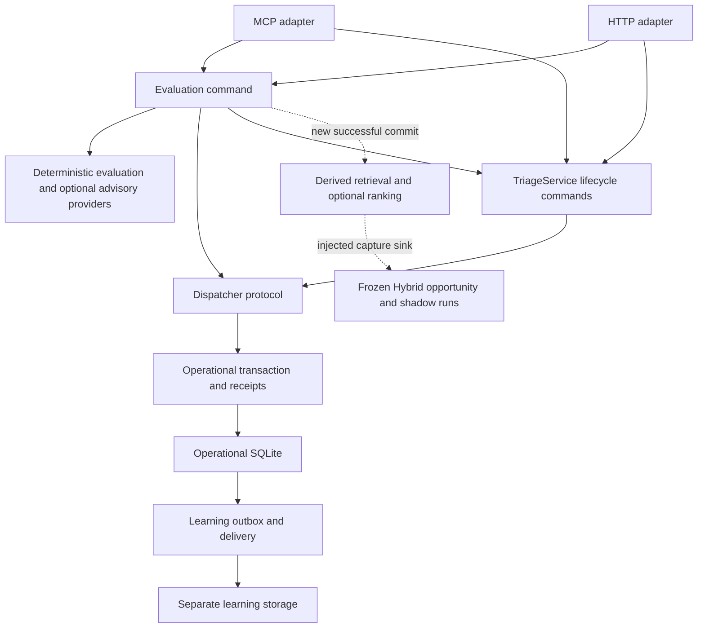

# Current Knotty module map

[Documentation index](README.md) · [Detailed module maps](modules/README.md) · [Progress](progress.md) · [Engineering reference](engineering-reference.md)

Last reconciled: **2026-10-31**. Runtime source inspected:
[`cc42b5c`](https://github.com/MatiasLaukka/Support-Ticket-Triage-MCP/tree/cc42b5c3d6e1f3f260005cd8966d006a7cc208c2),
the current GitHub `main` at inspection. This maintained map describes the major
module boundaries and execution paths, not every function or a fresh behavioral
audit. Relative source links refer to this documentation's checkout.

This is the codebase-wide connection map. Detailed function, important-state, and
call/data-flow maps live in `docs/modules/`. Initial detailed coverage is limited
to the foundational error/timeout boundary; the module-map index identifies gaps.

This is the current successor to the source inventory in the engineering
reference and the
[historical architecture audit](https://github.com/MatiasLaukka/Support-Ticket-Triage-MCP/blob/dcd865650f3b6ed34375390561bf0c65829a23d8/docs/architecture-review/module-map.md).
The audit remains pinned to `fe035ee`; its evidence and diagrams are not rewritten.

## Start here

| Question | Reading route |
| --- | --- |
| How is the application assembled? | [runtime](../src/runtime.ts), then the [MCP entry point](../src/index.ts) or [Approval Desk entry point](../src/approval-desk.ts) |
| How does an evaluation become a pending recommendation? | [evaluation command](../src/evaluation-command.ts), [AI evaluation](../src/approval-desk/ai-evaluation.ts), then [TriageService](../src/triage-service.ts) |
| Who permits and records a lifecycle change? | [policy](../src/policy.ts), [TriageService](../src/triage-service.ts), [dispatcher](../src/operational-command-dispatch.ts), [unit of work](../src/operational/unit-of-work.ts) |
| What does the operator see? | [workflow read model](../src/approval-desk/workflow-read-model.ts), [workflow guidance](../src/approval-desk/workflow-guidance.ts), [HTTP adapter](../src/approval-desk/http.ts) |
| How are retrieval and Hybrid reasoning isolated? | [retrieval observer](../src/retrieval/stage.ts), [capture boundary](../src/reasoning/hybrid-shadow-capture.ts), [shadow runner](../src/reasoning/hybrid-shadow-runner.ts) |

## Main module responsibilities

| Module or area | Responsibility and boundary |
| --- | --- |
| [index.ts](../src/index.ts), [approval-desk.ts](../src/approval-desk.ts) | Start MCP or HTTP transport; manage startup, shutdown, and safe startup errors. |
| [runtime.ts](../src/runtime.ts) | Validate environment, select persistence/providers, compose services, start learning delivery and optional retrieval, and close owned resources. |
| [errors.ts](../src/errors.ts), [timeout parsers](../src/utils/parse-openai-timeout.ts) | Foundational domain/startup error constructors and provider configuration parsing. `runtime.ts` re-exports the same `StartupConfigError` constructor for compatibility after PR #36. |
| [server.ts](../src/server.ts), [http.ts](../src/approval-desk/http.ts) | Validate transport input, call shared application commands, translate errors, and assemble responses. They do not independently authorize state changes. |
| [ui.ts](../src/approval-desk/ui.ts), [lifecycle-replay-ui.ts](../src/approval-desk/lifecycle-replay-ui.ts) | Embedded browser programs for the operator and replay views. Browser fetch/event relationships are not TypeScript import edges. |
| [evaluation-command.ts](../src/evaluation-command.ts) | Define evaluation request identity, prepare provider-assisted work outside the transaction, delegate authoritative commit/replay, and schedule optional post-commit observation. |
| [triage-service.ts](../src/triage-service.ts) | At this main baseline, owns recommendation and diagnosis/fix/close command families, validation, write-set construction, and immutable replay projections. Retains a separate file-backed compatibility path. |
| [operational-command-dispatch.ts](../src/operational-command-dispatch.ts), [idempotency.ts](../src/operational/idempotency.ts) | Parse/hash semantic requests, join in-flight duplicates within a dispatcher instance, reject identity conflicts, prepare work, and transact or recover committed results. |
| [operational/sqlite-store.ts](../src/operational/sqlite-store.ts), [unit-of-work.ts](../src/operational/unit-of-work.ts), [domain.ts](../src/operational/domain.ts) | Own operational SQLite, transaction-local writes, causal events, revisions, canonical messages, traces, command receipts, and result-reference integrity. |
| [runtime-repositories.ts](../src/operational/runtime-repositories.ts), [diagnosis-audit.ts](../src/operational/diagnosis-audit.ts), [timeline.ts](../src/operational/timeline.ts) | Adapt operational reads and reconstruct audit/timeline views. Operational read adapters reject direct legacy mutation methods. |
| [domain.ts](../src/domain.ts), [policy.ts](../src/policy.ts), [evidence-catalog.ts](../src/evidence-catalog.ts) | Shared schemas/vocabulary, deterministic approval/escalation rules, and evidence requirements. Models do not override these decisions. |
| [classifier.ts](../src/approval-desk/classifier.ts), [conversation-context.ts](../src/approval-desk/conversation-context.ts), [evidence-readiness.ts](../src/approval-desk/evidence-readiness.ts) | Classify accumulated context and compute evidence readiness; do not mutate operational state. |
| [ai-evaluation.ts](../src/approval-desk/ai-evaluation.ts), [recommendation-builder.ts](../src/approval-desk/recommendation-builder.ts) | Combine deterministic classification, optional accepted model signals, workflow context, knowledge, and bounded draft construction. |
| [classification provider](../src/approval-desk/classification-reasoning-provider.ts), [draft provider](../src/approval-desk/draft-response-provider.ts), [draft contract](../src/approval-desk/draft-contract.ts), [draft guardrails](../src/approval-desk/draft-quality-guardrails.ts) | Provider boundaries and validation/fallback for advisory classification and customer drafts. Optional network calls depend on configuration. |
| [taxonomy-inference.ts](../src/taxonomy-inference.ts), [taxonomy-stage.ts](../src/taxonomy-stage.ts), [taxonomy provider](../src/taxonomy-reasoning-provider.ts), [diagnostic-taxonomy.ts](../src/diagnostic-taxonomy.ts) | Deterministic/advisory diagnostic taxonomy and its contracts. Taxonomy does not replace operational routing authority. |
| [diagnostic-state.ts](../src/approval-desk/diagnostic-state.ts), [diagnostic-workflow.ts](../src/approval-desk/diagnostic-workflow.ts), [diagnosis-review.ts](../src/approval-desk/diagnosis-review.ts) | Select and validate diagnosis/review context and stale-state conditions. Authoritative transitions remain in the service. |
| [workflow-read-model.ts](../src/approval-desk/workflow-read-model.ts), [workflow-causal-context.ts](../src/approval-desk/workflow-causal-context.ts), [lifecycle.ts](../src/approval-desk/lifecycle.ts) | Project current allowed actions and causal history. Read models do not confer approval or mutation authority. |
| [knowledge-evolution/service.ts](../src/knowledge-evolution/service.ts), [discovery.ts](../src/knowledge-evolution/discovery.ts), [reusable-context.ts](../src/knowledge-evolution/reusable-context.ts) | Discover/draft candidates, govern review/promotion/versioning, and select approved reusable knowledge under evidence and time rules. |
| [sqlite-learning-ledger.ts](../src/knowledge-evolution/sqlite-learning-ledger.ts), [sqlite-knowledge-evolution-store.ts](../src/knowledge-evolution/sqlite-knowledge-evolution-store.ts), [learning-capture.ts](../src/knowledge-evolution/learning-capture.ts) | Own learning persistence, governed object storage, and capture. Learning availability is separate from operational availability. |
| [learning-outbox.ts](../src/operational/learning-outbox.ts), [learning-delivery-runner.ts](../src/operational/learning-delivery-runner.ts) | Deliver committed operational learning events to the learning subsystem with retry/recovery. This is not a cross-database transaction. |
| [retrieval/stage.ts](../src/retrieval/stage.ts), [execution.ts](../src/retrieval/execution.ts) | Build bounded queries, refresh/search the derived index, optionally rank results, and retain bounded observation traces. |
| [retrieval/sources.ts](../src/retrieval/sources.ts), [representations.ts](../src/retrieval/representations.ts), [index-manager.ts](../src/retrieval/index-manager.ts), [sqlite-store.ts](../src/retrieval/sqlite-store.ts) | Project eligible source material, version/hash representations, maintain derived lexical/vector state, and resolve source provenance. |
| [retrieval/search.ts](../src/retrieval/search.ts), [ranking.ts](../src/retrieval/ranking.ts), [applicability.ts](../src/retrieval/applicability.ts), [applicability provider](../src/applicability-reasoning-provider.ts) | Candidate discovery, optional policy-specific ranking, and separate experimental applicability assessment. Search results and relevance are not diagnoses or approvals. |
| [hybrid-shadow-capture.ts](../src/reasoning/hybrid-shadow-capture.ts), [input-assembler.ts](../src/reasoning/input-assembler.ts) | Freeze the committed opportunity and eligible retrieval/source material across the advisory capture boundary. |
| [hybrid-shadow-runner.ts](../src/reasoning/hybrid-shadow-runner.ts), [B5 adapter](../src/reasoning/b5-hybrid-reasoning-provider.ts), [shadow repository](../src/reasoning/sqlite-shadow-run-repository.ts) | Run/recover provider-identified advisory attempts and persist immutable results in separate shadow storage. The B5 adapter rejects diagnosis mode. |
| [ticket-repository.ts](../src/ticket-repository.ts), [recommendation-repository.ts](../src/recommendation-repository.ts), [audit-repository.ts](../src/audit-repository.ts), [knowledge-repository.ts](../src/knowledge-repository.ts) | File-backed compatibility/fixture adapters and knowledge article reads. Explicit legacy paths remain supported; absence from the default startup path is not permission to remove them. |
| [demo reset](../src/demo-reset.ts), [state lease](../src/demo-state-lease.ts), [metrics](../src/metrics.ts), [scripts](../scripts/) | Scoped reset/lease safeguards, metrics, demos, import/index utilities, and evaluation entry points. Their existence does not authorize resetting live state or running paid providers. |
| [seed data](../data/seed/), [knowledge articles](../data/knowledge/), [project launch configuration](../.codex/config.toml), [triage skill](../.agents/skills/triaging-support-tickets/) | Synthetic inputs, reference content, MCP launch wiring, and the repository's human-approval workflow instructions. |

## Execution and state ownership

The following is a simplified execution/ownership diagram, not an exhaustive
static import graph. Dashed arrows denote optional post-commit observation.

- **Startup:** entry points call `createRuntimeDependencies`; runtime selects
  adapters and manages leases/resources. Default operational storage is SQLite;
  `legacyFixtureRepositories` explicitly retains the file-backed route.
- **Evaluation:** providers prepare advice outside the write transaction. Commit
  rechecks the captured basis and stores a pending recommendation plus its
  receipt. A completed-command replay returns persisted results without another
  provider preparation.
- **Approval and lifecycle:** service validation and transaction-local checks
  enforce approved fields, revision/reply freshness, and workflow gates. Combined
  approval/send writes ordered events and a canonical support message atomically.
  Sending is a recorded local workflow action, not an external email integration.
- **Dispatcher scope:** runtime supplies an evaluation dispatcher, and
  `TriageService` retains its own lifecycle dispatcher. They use the operational
  store; an in-memory in-flight map is per instance, not a process-wide or
  cross-process lock. Durable command identity/result recovery lives in SQLite.
- **Readback:** immutable command-result references differ from HTTP/MCP response
  envelopes that may include freshly assembled workflow state. Event sequences,
  revisions, and canonical message references preserve causal context.
- **Automatic replies:** demonstration child intent is persisted with the parent;
  the facade executes it after the parent commit and can resume it during recovery.
- **Learning:** completed-diagnosis capture and candidate review/promotion use
  separate learning storage. The operational outbox bridges delivery; it does not
  combine the two databases into one atomic transaction.
- **Retrieval/shadow:** observation starts after a new successful evaluation
  commit and does not delay or authorize that command. Capture requires an
  injected sink. Optional provider/capture failures remain outside operational
  authority. Frozen-input reasoning and versioned shadow runs do not constitute
  an operational Hybrid diagnosis implementation.

## Verification and reading routes

These are existing test entry points, not new claims that they were executed by
this documentation change:

| Area | Tests |
| --- | --- |
| Composition and startup errors | [runtime](../test/runtime.test.ts), [entry point](../test/entrypoint.test.ts), [error identity](../test/errors.test.ts) |
| Evaluation, lifecycle and compatibility | [operational evaluation](../test/triage-operational-evaluation.test.ts), [recommendation lifecycle](../test/triage-operational-recommendation-lifecycle.test.ts), [diagnosis lifecycle](../test/triage-operational-diagnosis-lifecycle.test.ts), [runtime parity](../test/operational-runtime-parity.test.ts) |
| Recovery and replay | [dispatcher](../test/operational-command-dispatch.test.ts), [command replay](../test/reliability-command-replay.test.ts), [lifecycle replay](../test/reliability-lifecycle-replay.test.ts), [recovery](../test/operational-recovery.test.ts) |
| Policy and transports | [policy](../test/policy.test.ts), [HTTP](../test/approval-desk-http.test.ts), [MCP actions](../test/server-actions.test.ts) |
| Retrieval and isolated reasoning | [search](../test/retrieval-search.test.ts), [ranking](../test/retrieval-ranking.test.ts), [capture](../test/hybrid-shadow-capture.test.ts), [runner](../test/hybrid-shadow-runner.test.ts), [B5 adapter](../test/b5-hybrid-reasoning-provider.test.ts) |

Setup, commands, environment defaults, and operational safeguards remain in the
[root README](../README.md), [engineering reference](engineering-reference.md),
[knowledge guide](knowledge-evolution.md), and [security policy](../SECURITY.md).
Use synthetic fixtures and disposable state for verification; do not infer
permission to reset existing stores or run live model evaluations.

## Pending work, not merged architecture

Status checked on 2026-10-31. Verify GitHub and the working branch before editing
this section; it is not a permanent claim about these PRs.

| Change | Map consequence if incorporated |
| --- | --- |
| [PR #35: historical audit](https://github.com/MatiasLaukka/Support-Ticket-Triage-MCP/pull/35), open at `dcd8656` | Adds the detailed pinned audit and reproduction evidence. Keep its historical baseline separate from this maintained map. |
| [PR #37: retrieval readability](https://github.com/MatiasLaukka/Support-Ticket-Triage-MCP/pull/37), open at `931e7b8` | Clarifies `retrieval/search.ts` without intended ownership or behavior changes. Reconcile the status after review/merge. |
| [PR #38: lifecycle extraction](https://github.com/MatiasLaukka/Support-Ticket-Triage-MCP/pull/38), open at `cbcc590` | Moves operational recommendation commands and replay into `recommendation-lifecycle.ts`, shared projections into `operational-lifecycle-support.ts`, and input contracts into `recommendation-lifecycle-contracts.ts`. The facade retains public validation, legacy paths, and post-commit automatic-reply execution. Those modules are not yet in the main baseline described above. |

On a branch that includes PR #38, update the responsibility table, execution
description, source/test links, and inspected source identity to describe that
branch's actual implementation. Link its lifecycle contract document. A status
note alone is not sufficient once the owning code exists in the checkout.

## Maintenance convention

`AGENTS.md` defines documentation acceptance criteria. Maintain this file in the
same change as module/contract/ownership changes. Keep links from README and the
engineering-reference Repository Guide pointing here; do not reintroduce a
competing full module inventory. Keep diagrams conceptual and label omissions;
static graphs omit browser behavior, injected objects, and dynamic imports unless
explicitly analyzed. This document adds no implementation or research result.
