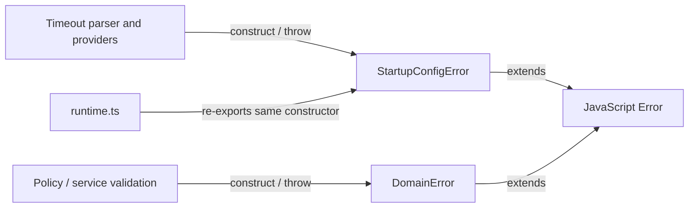

# Module map: foundational errors

Source: [src/errors.ts](../../src/errors.ts). Inspected runtime baseline:
`cc42b5c3d6e1f3f260005cd8966d006a7cc208c2` (2026-10-31).
Coverage: both exported classes and their own fields; caller examples below are
not an exhaustive call graph.

## Responsibility and symbols

This dependency-free module owns shared error constructors. It performs no I/O
and owns no mutable application store or module-level variable.

| Symbol/state | Contract and connections |
| --- | --- |
| `DomainErrorCode` | Type-only union for domain failure codes; it is not a runtime variable. |
| `DomainError(message, code)` | Extends JavaScript `Error`; stores the readonly `code` parameter property and sets `name` to `DomainError`. `message` comes from `Error`. Used by policy, repositories, and service validation. |
| `StartupConfigError(message)` | Extends `Error` and sets `name` to `StartupConfigError`; `message` is inherited. Configuration helpers and providers throw this constructor. |
| Per-instance `code`, `name`, `message` | Error metadata, not shared mutable module state. `code` belongs to `DomainError`; the other properties are error-instance fields. |

## Connections

[runtime.ts](../../src/runtime.ts) imports and re-exports the foundational startup
constructor. Existing imports through runtime and newer direct imports recognize
the same instance with `instanceof`; there is no wrapper subclass. See
[timeout parsing](utils/parse-openai-timeout.md),
[taxonomy provider](../../src/taxonomy-reasoning-provider.ts), and
[applicability provider](../../src/applicability-reasoning-provider.ts).

## Invariants and verification

Keep names, message behavior, prototype identity, and existing public re-exports
compatible when moving or changing constructors. Tests:
[constructor/parser identity](../../test/errors.test.ts),
[policy](../../test/policy.test.ts), and
[startup](../../test/entrypoint.test.ts). These are test navigation links, not a
claim that tests ran for this documentation-only change.
