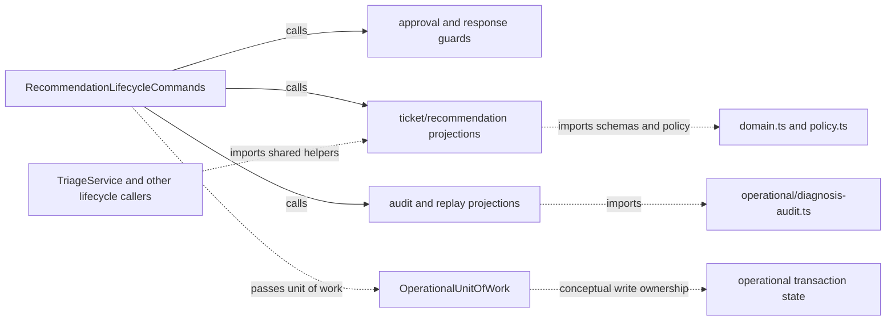

# Operational lifecycle support

[Connection map](../current-architecture.md) · [Module index](README.md) ·
[Recommendation commands](recommendation-lifecycle.md) ·
[Lifecycle contract](../ar-02-lifecycle-contract.md)

Source: [`src/operational-lifecycle-support.ts`](../../src/operational-lifecycle-support.ts),
PR #38 source head `cbcc590f843621b78918fc878a4594bf25caede3` (open draft,
unmerged). This partial map inventories the exported lifecycle helpers and the
private helpers that shape persisted projections. Other consumers are not
exhaustively traced.

## Responsibility and state

The module provides pure projections and guards over caller-supplied domain
values, workflow snapshots, readers, and transaction units. It appends a trace
only through the supplied unit of work and never opens a store or transaction.
It imports lifecycle contract types, domain/policy schemas, operational audit
helpers, and the `OperationalStoreError` boundary.

## Symbols

| Symbol | Role, data, ownership, and failure behavior |
| --- | --- |
| `OperationalApprovalFactValue` | Recursive persisted fact-value type for scalar and array values. |
| `appendLifecycleTrace` | Writes a lifecycle trace to a caller-owned unit of work using an injected UUID function; the enclosing transaction owns rollback. |
| `operationalAuditsFromSnapshot` | Reads command results from the unit, projects snapshot audits, and applies strict diagnosis-audit projection. Converts diagnosis audit integrity errors to `PERSISTENCE_ERROR`; other errors propagate. |
| `stale` | Creates `DomainError` with code `STALE_APPROVAL` for callers' stale-state checks. |
| `validateOperationalApproval` | Applies approved-field and escalation policy validation; rejects impermissible resulting routing before writes. |
| `approvedFieldValue`, `recommendationValue` | Resolve chosen values from field overrides/recommendation values; customer response uses edited text when supplied. |
| `recommendationAfterApproval` | Validates a recommendation projection with approved resolution and optional edited response. |
| `approvedTicketProjection`, `approvedValues`, `ticketValue`, `applyApprovedFields` | Compute selected before/after values and copy approved ticket fields. Ticket revision is incremented only when selected non-response fields change. `applyApprovedFields` clones input and validates the resulting ticket. |
| `sameStructuredValue` | Compares JSON-shaped values through serialization; used for receipt/history consistency checks. |
| `operationalApprovalFacts`, `encodeApprovalFact` | Encode selected fields into durable event facts. Unsupported nested/object values fail with `INVALID_APPROVAL_FIELDS`; null/undefined have explicit sentinels. |
| `replayIntegrity` | Wraps inconsistent immutable history as `OperationalStoreError` with `PERSISTENCE_ERROR`. |
| `readReplayWorkflowSnapshot` | Reads a snapshot from the result reader; missing-ticket `NOT_FOUND` becomes replay-integrity failure, while other store failures propagate. |
| `operationalRecommendationLifecycleAudit`, `approvalAuditValues`, `approvalFactPairs`, `decodeApprovalFact` | Project lifecycle audit before/after values from the event and persisted recommendation revision. Approval fields are reconstructed from persisted fact pairs and validated against `ApprovedFieldSchema`. |
| `operationalTransitionStaleMessage`, `operationalExpectedResolution`, `operationalExpectedResolutionForAnyLifecycle` | Map event action to established stale text and expected pre-transition resolution. |
| `assertOperationalResponseMayBeSent` | Requires an approved recommendation for the same ticket and exact approved response text; otherwise raises stale or invalid-field errors. |
| `assertOperationalResponseNotAlreadySent` | Scans supplied messages and rejects a second support response for the recommendation as stale. |
| `latestRecommendationBeforeEvent` | Finds the latest recommendation revision whose associated event precedes a sequence boundary; does not mutate the snapshot. |
| `operationalSupportResponseAudit`, `operationalCustomerReplyAudit`, `operationalSubmittedRecommendationAudit` | Project audit events from persisted event/message/revision inputs. Customer message ID remains the reply watermark. |
| `operationalConversationAuditsForEventIds` | Requires requested causal event IDs to exist in the same order, prefers recorded lifecycle audit results, and projects message/revision/event audits. Missing required immutable recommendation references fail with persistence-integrity errors. |
| `derivedOperationalCommandContext` | Uses SHA-256 of parent identity and action to derive a deterministic child command UUID-shaped identity. |
| `plusMilliseconds` | Computes an ISO timestamp offset. Invalid timestamps follow JavaScript date serialization failure behavior. |
| `compositeAutomaticReplySourceTicketMatchesHistory` | Compares a source ticket to the stored snapshot or approval revision reconstructed from event facts; malformed/missing evidence returns `false`. |
| `readNonnegativeInteger` | Narrows only integer numbers >= 0; other persisted values return `undefined`. |
| `operationalAuditEventsFromSnapshot` | Projects audits for every event through the causal event projector. |

The named helper groups above are descriptive, not a complete call graph. Local
values and every imported symbol are not separately mapped.

## Data and call relationships

Solid arrows identify direct calls by the recommendation family. Dotted arrows
denote imports or a conceptual ownership/data relationship; exact call usage from
all possible consumers is partial.

## Tests and related contract

- [Recommendation lifecycle tests](../../test/triage-operational-recommendation-lifecycle.test.ts)
- [Diagnosis lifecycle tests](../../test/triage-operational-diagnosis-lifecycle.test.ts)
- [Lifecycle replay tests](../../test/reliability-lifecycle-replay.test.ts)
- [Operational recovery tests](../../test/operational-recovery.test.ts)
- [AR-02 lifecycle contract and verification matrix](../ar-02-lifecycle-contract.md)

These test links are source navigation; this documentation remediation did not
rerun runtime suites.
