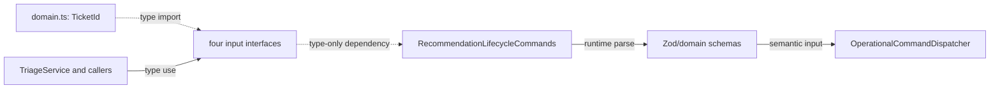

# Recommendation lifecycle input contracts

[Connection map](../current-architecture.md) · [Module index](README.md) ·
[TriageService boundary](triage-service-lifecycle-boundary.md) ·
[Lifecycle contract](../ar-02-lifecycle-contract.md)

Source: [`src/recommendation-lifecycle-contracts.ts`](../../src/recommendation-lifecycle-contracts.ts),
PR #38 source head `cbcc590f843621b78918fc878a4594bf25caede3` (open draft,
unmerged). This module defines caller-facing TypeScript shapes only; it has no
runtime validation, state, or effects.

## Symbols and boundary

| Symbol | Contract |
| --- | --- |
| `RejectRecommendationInput` | Recommendation/ticket IDs, actor, feedback, and rejection timestamp for a reject request. |
| `CancelApprovalInput` | Recommendation/ticket IDs, actor, cancellation reason, and cancellation timestamp. |
| `MarkResponseSentInput` | Recommendation/ticket IDs, actor, send timestamp, approved response text, and optional automatic-reply enablement. The operational command also supports an internal omitted response so it can use the approved draft. |
| `SupersedeRecommendationInput` | Recommendation/ticket IDs, actor, supersession timestamp, and reason. |

`TicketId` is imported as a type from the domain module. These interfaces do not
validate IDs, timestamps, nonblank strings, resolution state, or response
matching. `TriageService` and transport adapters apply runtime schemas; the
operational command parser repeats semantic-request checks before dispatch. The
interfaces preserve public facade compatibility while allowing the implementation
to live in `recommendation-lifecycle.ts`.

The diagram shows a type flow separately from runtime validation and calls; the
interfaces themselves do not cause the indicated runtime operations.

## Evidence

- [Recommendation command map](recommendation-lifecycle.md)
- [TriageService boundary map](triage-service-lifecycle-boundary.md)
- [AR-02 lifecycle contract](../ar-02-lifecycle-contract.md)
- [Recommendation lifecycle tests](../../test/triage-operational-recommendation-lifecycle.test.ts)
