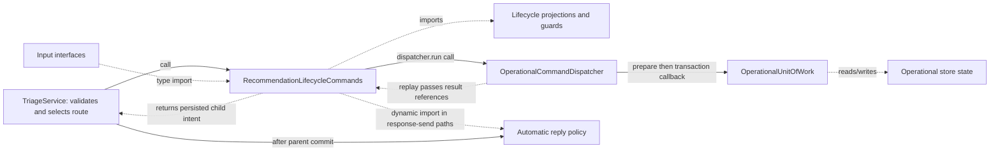

# Recommendation lifecycle commands

[Connection map](../current-architecture.md) · [Module index](README.md) ·
[TriageService boundary](triage-service-lifecycle-boundary.md) ·
[Lifecycle contract](../ar-02-lifecycle-contract.md)

Source: [`src/recommendation-lifecycle.ts`](../../src/recommendation-lifecycle.ts),
PR #38 source head `cbcc590f843621b78918fc878a4594bf25caede3` (open draft,
unmerged). This map covers the extracted recommendation operational command
family; it is based on source inspection, not an exhaustive call-graph analysis.

## Responsibility and state

`RecommendationLifecycleCommands` defines prepared operational commands for
approval, rejection, cancellation, supersession, sending an approved response,
and combined approval/send. The instance owns no persistent state. It receives
an `OperationalCommandDispatcher` and injected clock/UUID functions; command
callbacks read snapshots and mutate only the transaction's `OperationalUnitOfWork`.
`TriageService` remains responsible for public validation, route selection,
legacy repository-backed behavior, and post-commit automatic-reply execution.

## Important symbols

| Symbol | Role, inputs, effects, and failures |
| --- | --- |
| `NonBlankStringSchema`, `MarkResponseSentInputSchema` | Module-level Zod validators. The send schema requires a UUID recommendation, ticket ID, nonblank actor/response, ISO timestamp, and optional auto-reply flag; the prepared-command parser separately validates semantic intent. |
| `OperationalMarkResponseSentInput` | Internal prepared shape allowing response text to be omitted so commit can use the recommendation's approved draft. |
| `RecommendationLifecycleCommands` | Holds `dispatcher`, `now`, and `uuid` constructor fields; no database handle or mutable lifecycle cache. |
| `approveOperational` | Uses operation `approve-recommendation`; excludes generated `approvedAt` from semantic request identity, validates workflow/revision/reply freshness in commit, and writes event, recommendation revision, optional ticket revision, and trace in one unit of work. A `STALE_APPROVAL`, policy error, or persistence error aborts the command. |
| `replayOperationalApproval` | Resolves the receipt's event and recommendation revision and returns the recorded ticket snapshot. Missing immutable references raise a persistence error. |
| `reject`, `cancel`, `supersede` | Choose operation/action and expected/resulting resolution, then delegate to the shared transition handler. |
| `transitionOperationalRecommendation` | Parses UUID/ticket/actor/reason, prepares event time, checks expected resolution against the transaction snapshot, and appends event/revision/trace plus result reference. Store transaction rollback governs partial writes. |
| `replayOperationalTransition` | Reads the command's event/revision references and projects an audit. Missing or mismatched references fail closed as replay-integrity errors. |
| `markOperationalResponseSent` | Dynamically imports automatic-reply policy, parses semantic intent without event time, checks approved text, newer replies, and duplicate sends in the transaction, then stores event/message/trace and a snapshot-backed reply intent. It returns intent for the facade; it does not itself run the child reply. |
| `replayOperationalResponseSent` | Resolves the immutable sent event/message and pre-send audit references for the original result. Missing references are persistence-integrity failures. |
| `approveAndMarkOperationalResponseSent` | Prepares one composite command and writes approval and send records in one unit of work; commit enforces pending status, source revision, causal freshness, and response match. |
| `replayOperationalApprovalAndSend` | Reconstructs the composite response from the receipt's approval, send, message, and pre-send references; inconsistent references fail as persistence errors. |
| `automaticCustomerReplyIntent` | Derives a child command intent from the committed parent basis, eligibility, and existing audit history; the result is persisted with the parent receipt. |
| `assertAutomaticCustomerReplyIntent`, `assertPersistedAutomaticCustomerReplyIntent` | Compare deterministic child intent with semantic request and stored result. Identity or history inconsistencies throw `OperationalStoreError`. |

The parser/preparation/commit/replay callbacks use the
[`PreparedCommandDefinition`](../../src/operational-command-dispatch.ts) contract.
The dispatcher checks a stored receipt before preparation, then executes
preparation outside the transaction and commit/result persistence inside the
unit of work. The dispatcher and its receipt code own idempotency semantics; this
module supplies operation identity and lifecycle projections. A replay reads
stored event/revision/message/snapshot references rather than reapplying a write.

## Connections and flow

The arrows distinguish calls from type/import and data relationships. The
automatic-reply policy has lazy imports; a static import inventory alone will
not show the complete runtime dependency. The actual facade behavior is scoped in
the [TriageService map](triage-service-lifecycle-boundary.md).

## Related evidence

- [Recommendation lifecycle tests](../../test/triage-operational-recommendation-lifecycle.test.ts)
- [Dispatcher tests](../../test/operational-command-dispatch.test.ts)
- [Lifecycle replay tests](../../test/reliability-lifecycle-replay.test.ts)
- [Command replay tests](../../test/reliability-command-replay.test.ts)
- [Operational recovery tests](../../test/operational-recovery.test.ts)

These are related suites, not a claim they were rerun for this documentation-only
remediation. The adjacent [AR-02 contract](../ar-02-lifecycle-contract.md)
records the earlier characterization baseline and verification matrix.
