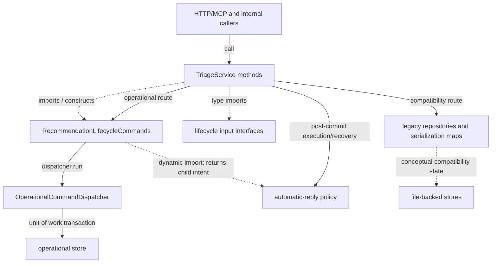

# TriageService lifecycle boundary

[Connection map](../current-architecture.md) · [Module index](README.md) ·
[Recommendation commands](recommendation-lifecycle.md) ·
[Input contracts](recommendation-lifecycle-contracts.md) ·
[Lifecycle contract](../ar-02-lifecycle-contract.md)

Source: [`src/triage-service.ts`](../../src/triage-service.ts), PR #38 source
head `cbcc590f843621b78918fc878a4594bf25caede3` (open draft, unmerged). Scope is
the extracted recommendation lifecycle boundary only. The service is large;
evaluation internals and diagnosis/fix/close methods are intentionally not mapped
here.

## Responsibility and state

`TriageService` remains the public application facade. For recommendation
lifecycle calls it parses public inputs, enforces an explicit command context
when an operational store is configured, selects the operational command family
or the file-backed compatibility path, and runs automatic-reply child intent
after a parent operation returns. It retains evaluation and other lifecycle
families outside this extraction.

Relevant important fields on `TriageService`:

| Field | Ownership and use |
| --- | --- |
| `dependencies` | Caller-supplied repositories, optional operational store, policies, providers, and hooks; store availability selects operational versus compatibility behavior. |
| `now` | Injected/default clock used for generated timestamps and passed to lifecycle command instances. |
| `uuid` | Injected/default ID source passed to lifecycle command instances. |
| `commandDispatcher` | One dispatcher per service instance when the configured store satisfies the dispatchable-store boundary; absent for legacy-only stores. Its in-flight map is instance-local. |

The module-level `recommendationOperations` and `ticketOperations` maps serialize
legacy compatibility work. Private capability symbols gate internal submission
and classifier-confidence routes; `NEWER_REPLY_SUPERSESSION_REASON` preserves the
reason used when a newer reply supersedes a recommendation. These symbols are
listed for this boundary, not treated as module-wide inventory.

## Scoped methods

| Method | Role and behavior |
| --- | --- |
| `constructor` | Sets clock and ID defaults and creates a dispatcher only for a dispatchable operational store. |
| `operationalDispatcher` | Returns the configured dispatcher or fails with `NOT_INITIALIZED` when replayable operational mutations require a missing dispatcher. |
| `recommendationLifecycle` | Constructs the extracted family with the shared dispatcher and service clock/ID sources. |
| `approve` | Parses `Approval`; operational path requires command context and delegates to the family. Compatibility path serializes by ticket/recommendation and calls the legacy validated transition. |
| `reject` | Parses rejection input and routes to the family with required operational context or the legacy serialized path. |
| `cancelApproval` | Parses cancellation input and routes similarly. |
| `markResponseSent` | Parses send input and delegates to the operational family, returning its audit; compatibility path calls the legacy sender. |
| `markResponseSentWithAutomaticReply` | Delegates the parent send, then runs returned child intent after it resolves; returns the optional child audit. |
| `markResponseSentFromWorkflow` | Builds timestamped operational input and workflow semantic identity, delegates send, then executes child intent after parent completion. |
| `approveAndMarkResponseSent` | Validates approval and response inputs, delegates one operational composite command when a store is configured, then runs automatic-reply intent after commit; the compatibility route keeps its own orchestration. |
| `supersedeRecommendation` | Parses its request and performs operational supersession through the extracted family, or uses the legacy serialized transition. |
| `runAutomaticCustomerReply` | Owns post-parent execution of a persisted child intent; failures occur after the parent command and do not roll it back. |

Other service methods can call lifecycle helpers (for example evaluation reply
handling and newer-reply supersession), but those wider paths are outside this
map. Direct calls, imports, and conceptual data relationships are separated
below.

## Calls and data flow

The diagram is scoped and not a static whole-service graph. Automatic-reply code
is dynamically imported by lifecycle command paths; TriageService executes the
returned child intent after the parent command. Operational writes are delegated
through dispatcher and unit-of-work interfaces. Legacy locks/maps are process
local and are distinct from durable operational command receipts.

## Related checks and documents

- [Recommendation lifecycle tests](../../test/triage-operational-recommendation-lifecycle.test.ts)
- [Operational runtime parity tests](../../test/operational-runtime-parity.test.ts)
- [Operational evaluation tests](../../test/triage-operational-evaluation.test.ts)
- [Lifecycle replay tests](../../test/reliability-lifecycle-replay.test.ts)
- [AR-02 lifecycle contract](../ar-02-lifecycle-contract.md)
- [Current architecture](../current-architecture.md)

The links identify relevant suites, not tests executed by this documentation-only
change.
