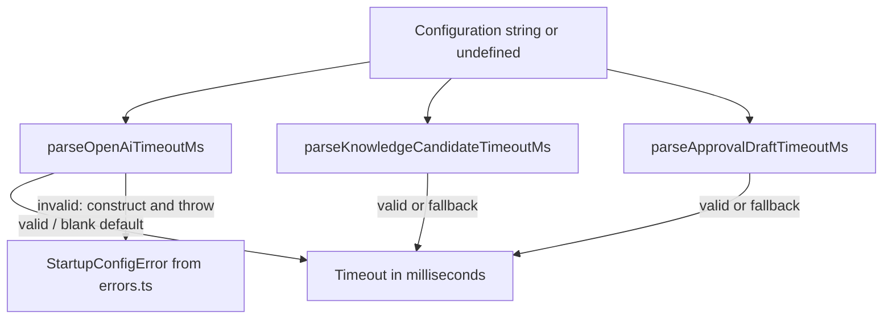

# Module map: provider timeout parsing

Source: [src/utils/parse-openai-timeout.ts](../../../src/utils/parse-openai-timeout.ts).
Inspected runtime baseline: `cc42b5c3d6e1f3f260005cd8966d006a7cc208c2`
(2026-10-31). Coverage: all three exported functions and their direct error
dependency; provider caller examples are not exhaustive.

## Responsibility and symbols

Pure configuration parsing with no I/O, persistent state, class fields, or
module-level variables. Each function accepts `string | undefined` and returns a
number. The default `20_000` milliseconds is a literal in each function, not an
exported constant.

| Function | Behavior and failure contract |
| --- | --- |
| `parseOpenAiTimeoutMs(value)` | Undefined/blank returns `20_000`; otherwise converts with `Number` and accepts finite positive integers. Invalid input throws the foundational `StartupConfigError` with the existing `TRIAGE_OPENAI_TIMEOUT_MS` message. |
| `parseKnowledgeCandidateTimeoutMs(value)` | Uses the same default/conversion/positive-integer check, but invalid input returns `20_000` instead of throwing. |
| `parseApprovalDraftTimeoutMs(value)` | Uses the same default/conversion/positive-integer check and preserves the invalid-input fallback to `20_000`. |

## Connections and data flow

The functions do not call one another. All use built-in string/number checks; only
the strict parser constructs an error. [runtime.ts](../../../src/runtime.ts)
consumes knowledge-candidate timeout parsing, the
[draft provider](../../../src/approval-desk/draft-response-provider.ts) consumes
approval-draft parsing, and the
[taxonomy provider](../../../src/taxonomy-reasoning-provider.ts) consumes strict
OpenAI timeout parsing. See the [error map](../errors.md) for constructor identity.

## Invariants and verification

Preserve the strict/fallback distinction, default, numeric coercion, message, and
constructor identity. A convenience rewrite must not silently change accepted
formats or add a new safe-integer/upper-bound restriction. Tests:
[provider timeout configuration](../../../test/openai-timeout-config.test.ts) and
[error identity/parser behavior](../../../test/errors.test.ts). No live provider
call or new runtime-test result is implied by this map.
